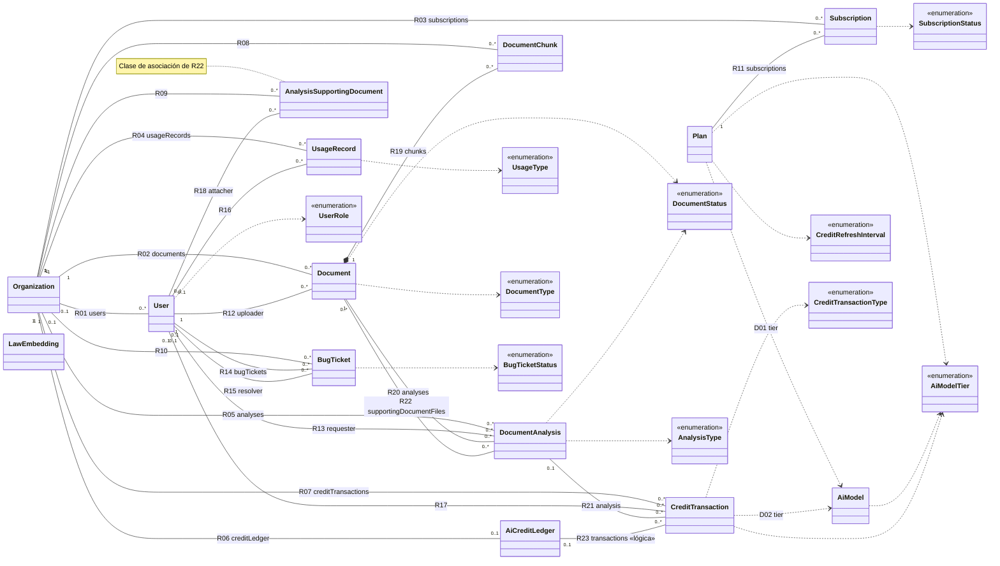
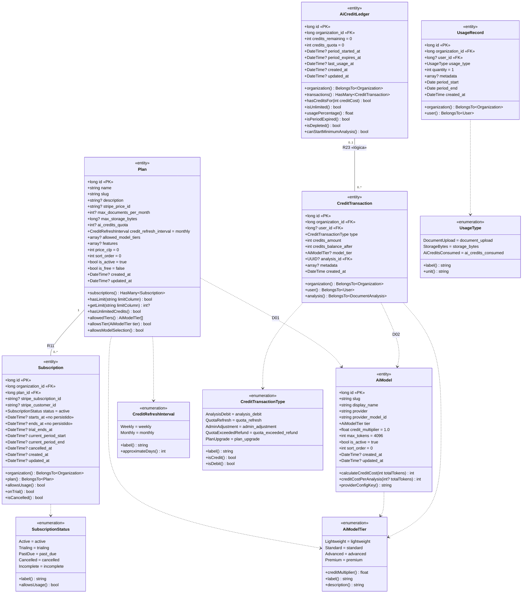
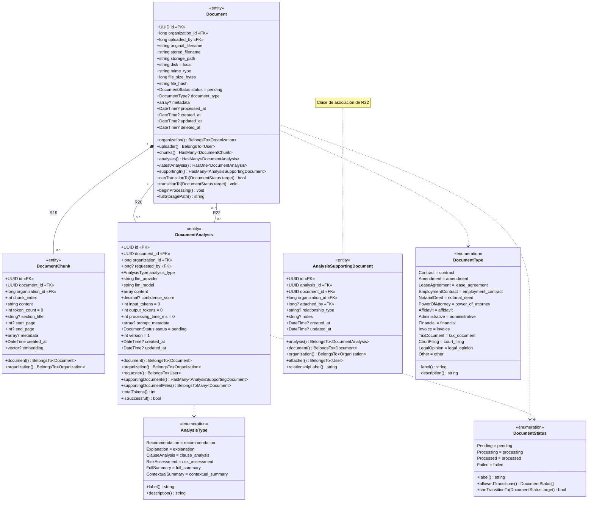
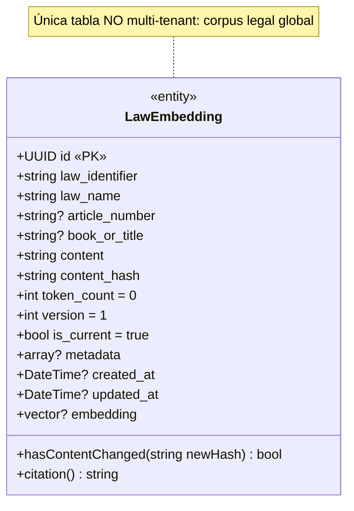
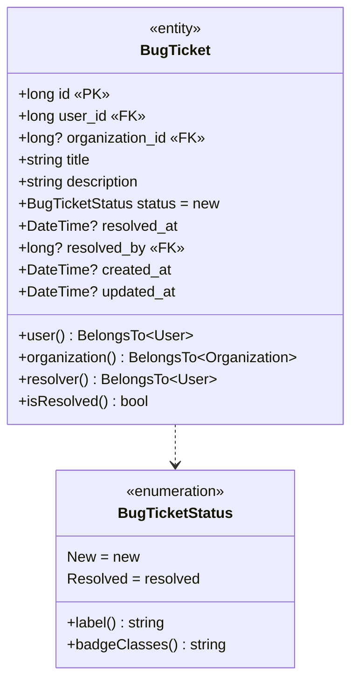

# Diagrama de Clases — Modelo de Dominio de Auditor-IA

> Guía de referencia **y** guion paso a paso para recrear el diagrama de clases del dominio en **Sparx Enterprise Architect 15.x**.
>
> **Fuentes de verdad:** [`app/Models`](app/Models) (14 clases), [`app/Enums`](app/Enums) (10 enumeraciones) y [`database/migrations`](database/migrations) (tipos exactos, nulabilidad, valores por defecto, FKs y reglas `ON DELETE`).
>
> Los nombres de clases, atributos y métodos se mantienen en inglés (tal como están en el código).

---

## Índice

0. [Cómo usar esta guía](#0-cómo-usar-esta-guía)
1. [Diagrama de referencia (Mermaid)](#1-diagrama-de-referencia-mermaid)
2. [Fase 1 — Preparación del proyecto en EA](#2-fase-1--preparación-del-proyecto-en-ea)
3. [Fase 2 — Crear las 10 enumeraciones](#3-fase-2--crear-las-10-enumeraciones)
4. [Fase 3 — Crear las 14 clases](#4-fase-3--crear-las-14-clases)
5. [Fase 4 — Relaciones (tabla maestra de conectores)](#5-fase-4--relaciones-tabla-maestra-de-conectores)
6. [Fase 5 — Dependencias hacia enumeraciones](#6-fase-5--dependencias-hacia-enumeraciones)
7. [Fase 6 — Disposición, estilo y verificación](#7-fase-6--disposición-estilo-y-verificación)
8. [Apéndice — Notas de modelado y discrepancias conocidas](#8-apéndice--notas-de-modelado-y-discrepancias-conocidas)

---

## 0. Cómo usar esta guía

| Ítem | Valor |
|---|---|
| Versión de EA | **15.x** (formato de proyecto `.eapx`; el formato `.qea` aparece recién en la 16) |
| Tiempo estimado | 4 – 6 horas (la Fase 3 concentra ~60 % del trabajo) |
| Orden obligatorio | Fase 1 → 2 → 3 → 4 → 5 → 6 (las enumeraciones deben existir antes de tipar atributos con ellas, y las clases antes de los conectores) |
| Alcance | Solo dominio: **sin** `Model` ni `Authenticatable` (no hay generalizaciones hacia el framework) |
| Método | Construcción **100 % manual** (sin ingeniería inversa de código) |

Cada bloque de trabajo termina con una casilla `- [ ] Hecho` para que uses el documento como lista de tareas.

### 0.1 Criterio de inclusión de operaciones

| Se incluye | Se excluye |
|---|---|
| Métodos de relación Eloquent (`belongsTo`, `hasMany`, `hasOne`, `belongsToMany`) | Scopes (`scopeXxx()`) |
| Métodos de instancia **públicos** de negocio | Métodos `static` (`Plan::freePlan()`, `AiModel::findBySlug()`, `AiModel::defaultModel()`, `Organization::boot()`) |
| Métodos de instancia **privados** (`Organization::calculatePeriodExpiry()`) | Hooks/configuración del framework (`casts()`) |

Al final de cada ficha de clase hay una línea **"Excluidos"** que enumera exactamente lo que quedó fuera, para que la verificación cruzada contra el código sea trivial.

### 0.2 Leyenda

| Símbolo / estereotipo | Significado |
|---|---|
| `+` | Visibilidad pública |
| `-` | Visibilidad privada (también se usa para atributos listados en `$hidden`) |
| `«entity»` | Clase persistida (modelo Eloquent) |
| `«enumeration»` | Enum respaldado (`BackedEnum: string`) |
| `«PK»` / `«FK»` | Estereotipo de atributo para clave primaria / foránea |
| `«no persistido»` | Atributo declarado en el modelo pero sin columna en BD (ver Apéndice) |
| `«lógica»` | Asociación sin FK real en la BD |
| `/nombre()` | Relación **derivada** (subconjunto filtrado de otra relación; no genera conector propio) |
| `0..1`, `1`, `0..*` | Multiplicidad UML |

### 0.3 Mapeo Laravel → UML / EA

| Concepto Laravel | Elemento UML / EA |
|---|---|
| `belongsTo` ↔ `hasMany` | Association, multiplicidad `1` (o `0..1` si la FK es nullable) ↔ `0..*` |
| `hasOne` (con FK `UNIQUE`) | Association `1` ↔ `0..1` |
| `belongsToMany` + modelo pivote | **Association Class** |
| `cascadeOnDelete` en un hijo que no tiene sentido sin el padre | **Composition** (solo `Document` ◆— `DocumentChunk`; los vínculos de tenant se dibujan como asociaciones para no saturar el diagrama y la regla `ON DELETE` se registra como *tagged value*) |
| Atributo con `cast` a enum | Atributo tipado con el enum + **Dependency** hacia el enum |
| `hasOne(...)->ofMany()` / `hasOne(...)->where()` | Operación derivada `/nombre()` |
| Traits (`HasUuids`, `SoftDeletes`, `HasApiTokens`, …) | *Tagged value* `traits` en la clase |
| Columna nullable | Multiplicidad del atributo `[0..1]` |
| `default(...)` en migración | *Initial Value* del atributo |

### 0.4 Mapeo de tipos BD → UML

| Tipo en migración | Tipo UML en EA | Observación |
|---|---|---|
| `id()` / `foreignId()` (bigint unsigned) | `long` | |
| `uuid` | `UUID` | |
| `string(n)` | `string` | La longitud va en la columna *Tipo BD* (puedes copiarla al campo *Notes* o como *tagged value* `length`) |
| `text` / `longText` | `string` | |
| `integer` | `int` | Admite negativos |
| `unsignedInteger` / `unsignedSmallInteger` | `int` | Restricción `{>= 0}` |
| `unsignedBigInteger` | `long` | Restricción `{>= 0}` |
| `boolean` | `bool` | |
| `decimal(3,2)` | `decimal` | |
| `decimal(3,1)` con cast `float` | `float` | |
| `json` con cast `array` | `array` | |
| `timestamp` | `DateTime` | |
| `date` | `Date` | |
| `vector(1536)` (pgvector) | `vector` | Fallback `json` si la extensión no existe |
| `string` con cast a enum | `<NombreDelEnum>` | |

---

## 1. Diagrama de referencia (Mermaid)

> [!NOTE]
> Estos diagramas son la "foto de la caja": úsalos para comparar mientras construyes en EA. GitHub los renderiza de forma nativa; en VS Code necesitas una extensión de vista previa de Mermaid. El diagrama 1.1 muestra **solo la estructura** (clases y conectores) para que se lea en una pantalla; los diagramas 1.2–1.6 muestran los miembros completos por paquete.

### 1.1 Vista completa (estructura)



### 1.2 Paquete «Tenencia e Identidad»

```mermaid
classDiagram
    class Organization {
        <<entity>>
        +long id «PK»
        +UUID uuid
        +string name
        +string slug
        +string? tax_id
        +bool is_active = true
        +array? settings
        +DateTime? created_at
        +DateTime? updated_at
        +DateTime? deleted_at
        +users() HasMany~User~
        +documents() HasMany~Document~
        +subscriptions() HasMany~Subscription~
        +/activeSubscription() HasOne~Subscription~
        +usageRecords() HasMany~UsageRecord~
        +analyses() HasMany~DocumentAnalysis~
        +creditLedger() HasOne~AiCreditLedger~
        +creditTransactions() HasMany~CreditTransaction~
        +activePlan() Plan?
        +currentPlan() Plan
        +currentPlanSlug() string
        +hasProAccess() bool
        +getOrCreateCreditLedger() AiCreditLedger
        -calculatePeriodExpiry(Plan plan) Carbon
    }
    class User {
        <<entity>>
        +long id «PK»
        +long? organization_id «FK»
        +string name
        +string email
        +DateTime? email_verified_at
        -string password
        +UserRole role = user
        -string? remember_token
        +bool dismissed_tutorial = false
        +bool dismissed_ancillary_tutorial = false
        +string? avatar_path
        +DateTime? created_at
        +DateTime? updated_at
        +organization() BelongsTo~Organization~
        +documents() HasMany~Document~
        +analyses() HasMany~DocumentAnalysis~
        +bugTickets() HasMany~BugTicket~
        +isOwner() bool
        +isAdmin() bool
        +isAuditor() bool
        +isUser() bool
        +hasRole(UserRole... roles) bool
        +canManageUsers() bool
        +canManageBilling() bool
        +canManageSettings() bool
        +canMutateDocuments() bool
        +hasOrganization() bool
        +belongsToOrganization(int organizationId) bool
        +hasProAccess() bool
        +avatarUrl() string?
        +initials() string
    }
    class UserRole {
        <<enumeration>>
        Owner = owner
        Admin = admin
        Auditor = auditor
        User = user
        +label() string
        +badgeClasses() string
        +hierarchyRank() int
        +canManageUsers() bool
        +canManageBilling() bool
        +canManageSettings() bool
        +canMutateDocuments() bool
    }
    Organization "0..1" -- "0..*" User : R01
    User ..> UserRole
```



### 1.3 Paquete «Facturación y Créditos»



### 1.4 Paquete «Documentos y Análisis»



### 1.5 Paquete «Base de Conocimiento (global)»



### 1.6 Paquete «Soporte»



---

## 2. Fase 1 — Preparación del proyecto en EA

### 2.1 Crear el proyecto

1. Abre EA 15 y usa el botón de menú principal (icono de EA, arriba a la izquierda) → **New Project…** (`Ctrl+N`).
2. Guarda el archivo como `auditor-ia-dominio.eapx` (puedes guardarlo en una carpeta `docs/` del repositorio si quieres versionarlo).
3. Si se abre el **Model Wizard** (*Start Here*), ciérralo sin seleccionar plantillas: construiremos todo desde cero.
4. Abre la ventana **Browser** (`Alt+0`) si no está visible.

- [ ] Hecho

### 2.2 Estructura de paquetes

1. En el Browser, selecciona el nodo raíz (por defecto `Model`), pulsa `F2` y renómbralo a **`Auditor-IA`**.
2. Clic derecho sobre `Auditor-IA` → **Add View…** → nombre **`Modelo de Dominio`** → tipo *Class View*.
3. Selecciona `Modelo de Dominio` y crea los 5 paquetes (clic derecho → **Add a Package…**, o `Ctrl+W`). En el diálogo, elige **Package Only** (sin diagrama):

| # | Paquete | Contenido |
|---|---|---|
| P1 | `Tenencia e Identidad` | `Organization`, `User`, `UserRole` |
| P2 | `Facturación y Créditos` | `Plan`, `Subscription`, `UsageRecord`, `AiModel`, `AiCreditLedger`, `CreditTransaction`, `SubscriptionStatus`, `UsageType`, `AiModelTier`, `CreditRefreshInterval`, `CreditTransactionType` |
| P3 | `Documentos y Análisis` | `Document`, `DocumentChunk`, `DocumentAnalysis`, `AnalysisSupportingDocument`, `DocumentStatus`, `DocumentType`, `AnalysisType` |
| P4 | `Base de Conocimiento` | `LawEmbedding` |
| P5 | `Soporte` | `BugTicket`, `BugTicketStatus` |

- [ ] Hecho

### 2.3 Crear el diagrama

1. Clic derecho sobre `Modelo de Dominio` → **Add Diagram…**
2. Nombre: **`Diagrama de Clases — Dominio`**. Tipo: **UML Structural → Class**. Aceptar.
3. Haz doble clic en un área vacía del diagrama para abrir sus **Properties**:
   - Pestaña **Diagram**: activa *Show Package Name* solo si quieres ver el paquete de origen de cada clase (recomendado: desactivado).
   - Pestaña **Elements** (o *Features* según la build): activa *Show Attributes*, *Show Operations*, *Show Element Stereotypes* y *Show Feature Stereotypes*. En *Operations* elige mostrar parámetros con nombre y tipo.
   - Pestaña **Connectors**: activa *Show Stereotype Labels*.

- [ ] Hecho

### 2.4 Tipos de datos (opcional)

EA acepta **texto libre** en el campo *Type* de atributos y parámetros, así que puedes escribir directamente `UUID`, `DateTime`, `array`, `vector`, etc. Si prefieres que aparezcan en el desplegable:

1. Crea un paquete adicional `Tipos` dentro de `Modelo de Dominio`.
2. Dentro, crea elementos de tipo **DataType** (`Ctrl+M` → *Toolset: UML Structural* → *DataType*): `long`, `int`, `float`, `decimal`, `bool`, `string`, `array`, `UUID`, `DateTime`, `Date`, `vector`, `Carbon`.
3. No arrastres este paquete al diagrama: solo sirve como catálogo de tipos.

> [!TIP]
> Deja el **Language** de cada clase en `<none>`. Si eliges `PHP`, EA intentará validar los tipos contra su catálogo de PHP y algunos (`UUID`, `vector`) no aparecerán.

- [ ] Hecho

---

## 3. Fase 2 — Crear las 10 enumeraciones

### 3.1 Pasos en EA (una vez, completos)

1. En el Browser, selecciona el paquete destino (ver columna *Paquete* abajo) → `Ctrl+M` (**New Element**) → *Toolset*: **UML Structural** → *Type*: **Enumeration** → escribe el nombre → **OK**.
2. Con el enum seleccionado, pulsa `F9` (ventana **Features → Attributes**). Para cada literal:
   - **Name**: nombre del *case* (p. ej. `Pending`).
   - **Initial Value**: valor respaldado entre comillas simples (p. ej. `'pending'`).
   - Deja **Type** vacío y **Scope** en *Public*. EA marca automáticamente el atributo como literal dentro de una *Enumeration*.
3. Pulsa `F10` (**Features → Operations**). Para cada operación: **Name**, **Return Type**, **Scope** = *Public*; los parámetros se agregan con el botón de parámetros de la fila.
4. Arrastra el enum desde el Browser al diagrama (suelta como **Link**), en la zona de su paquete.

> [!NOTE]
> Todas las enumeraciones son `string`-backed. Puedes registrar esto con un *tagged value* `backingType = string` (`Ctrl+Shift+6` abre la ventana de Tagged Values).

### 3.2 Fichas de enumeraciones

#### E1 · `UserRole` — Paquete P1 · [UserRole.php](app/Enums/UserRole.php)

| Literal | Valor |
|---|---|
| `Owner` | `'owner'` |
| `Admin` | `'admin'` |
| `Auditor` | `'auditor'` |
| `User` | `'user'` |

| Operación | Parámetros | Retorno |
|---|---|---|
| `label` | — | `string` |
| `badgeClasses` | — | `string` |
| `hierarchyRank` | — | `int` |
| `canManageUsers` | — | `bool` |
| `canManageBilling` | — | `bool` |
| `canManageSettings` | — | `bool` |
| `canMutateDocuments` | — | `bool` |

- [ ] Hecho

#### E2 · `SubscriptionStatus` — Paquete P2 · [SubscriptionStatus.php](app/Enums/SubscriptionStatus.php)

| Literal | Valor |
|---|---|
| `Active` | `'active'` |
| `Trialing` | `'trialing'` |
| `PastDue` | `'past_due'` |
| `Cancelled` | `'cancelled'` |
| `Incomplete` | `'incomplete'` |

| Operación | Parámetros | Retorno |
|---|---|---|
| `label` | — | `string` |
| `allowsUsage` | — | `bool` |

- [ ] Hecho

#### E3 · `UsageType` — Paquete P2 · [UsageType.php](app/Enums/UsageType.php)

| Literal | Valor |
|---|---|
| `DocumentUpload` | `'document_upload'` |
| `StorageBytes` | `'storage_bytes'` |
| `AiCreditsConsumed` | `'ai_credits_consumed'` |

| Operación | Parámetros | Retorno |
|---|---|---|
| `label` | — | `string` |
| `unit` | — | `string` |

- [ ] Hecho

#### E4 · `AiModelTier` — Paquete P2 · [AiModelTier.php](app/Enums/AiModelTier.php)

| Literal | Valor |
|---|---|
| `Lightweight` | `'lightweight'` |
| `Standard` | `'standard'` |
| `Advanced` | `'advanced'` |
| `Premium` | `'premium'` |

| Operación | Parámetros | Retorno |
|---|---|---|
| `creditMultiplier` | — | `float` |
| `label` | — | `string` |
| `description` | — | `string` |

- [ ] Hecho

#### E5 · `CreditRefreshInterval` — Paquete P2 · [CreditRefreshInterval.php](app/Enums/CreditRefreshInterval.php)

| Literal | Valor |
|---|---|
| `Weekly` | `'weekly'` |
| `Monthly` | `'monthly'` |

| Operación | Parámetros | Retorno |
|---|---|---|
| `label` | — | `string` |
| `approximateDays` | — | `int` |

- [ ] Hecho

#### E6 · `CreditTransactionType` — Paquete P2 · [CreditTransactionType.php](app/Enums/CreditTransactionType.php)

| Literal | Valor |
|---|---|
| `AnalysisDebit` | `'analysis_debit'` |
| `QuotaRefresh` | `'quota_refresh'` |
| `AdminAdjustment` | `'admin_adjustment'` |
| `QuotaExceededRefund` | `'quota_exceeded_refund'` |
| `PlanUpgrade` | `'plan_upgrade'` |

| Operación | Parámetros | Retorno |
|---|---|---|
| `label` | — | `string` |
| `isCredit` | — | `bool` |
| `isDebit` | — | `bool` |

- [ ] Hecho

#### E7 · `DocumentStatus` — Paquete P3 · [DocumentStatus.php](app/Enums/DocumentStatus.php)

| Literal | Valor |
|---|---|
| `Pending` | `'pending'` |
| `Processing` | `'processing'` |
| `Processed` | `'processed'` |
| `Failed` | `'failed'` |

| Operación | Parámetros | Retorno |
|---|---|---|
| `label` | — | `string` |
| `allowedTransitions` | — | `DocumentStatus[]` |
| `canTransitionTo` | `target: DocumentStatus` | `bool` |

> [!TIP]
> Las transiciones válidas son `Pending → Processing | Failed`, `Processing → Processed | Failed`, `Failed → Pending` (reintento) y `Processed` es terminal. Si quieres documentarlas, agrega una **Note** enlazada al enum, o modela una máquina de estados separada (fuera del alcance de este diagrama).

- [ ] Hecho

#### E8 · `DocumentType` — Paquete P3 · [DocumentType.php](app/Enums/DocumentType.php)

| Literal | Valor |
|---|---|
| `Contract` | `'contract'` |
| `Amendment` | `'amendment'` |
| `LeaseAgreement` | `'lease_agreement'` |
| `EmploymentContract` | `'employment_contract'` |
| `NotarialDeed` | `'notarial_deed'` |
| `PowerOfAttorney` | `'power_of_attorney'` |
| `Affidavit` | `'affidavit'` |
| `Administrative` | `'administrative'` |
| `Financial` | `'financial'` |
| `Invoice` | `'invoice'` |
| `TaxDocument` | `'tax_document'` |
| `CourtFiling` | `'court_filing'` |
| `LegalOpinion` | `'legal_opinion'` |
| `Other` | `'other'` |

| Operación | Parámetros | Retorno |
|---|---|---|
| `label` | — | `string` |
| `description` | — | `string` |

- [ ] Hecho

#### E9 · `AnalysisType` — Paquete P3 · [AnalysisType.php](app/Enums/AnalysisType.php)

| Literal | Valor |
|---|---|
| `Recommendation` | `'recommendation'` |
| `Explanation` | `'explanation'` |
| `ClauseAnalysis` | `'clause_analysis'` |
| `RiskAssessment` | `'risk_assessment'` |
| `FullSummary` | `'full_summary'` |
| `ContextualSummary` | `'contextual_summary'` |

| Operación | Parámetros | Retorno |
|---|---|---|
| `label` | — | `string` |
| `description` | — | `string` |

- [ ] Hecho

#### E10 · `BugTicketStatus` — Paquete P5 · [BugTicketStatus.php](app/Enums/BugTicketStatus.php)

| Literal | Valor |
|---|---|
| `New` | `'new'` |
| `Resolved` | `'resolved'` |

| Operación | Parámetros | Retorno |
|---|---|---|
| `label` | — | `string` |
| `badgeClasses` | — | `string` |

- [ ] Hecho

---

## 4. Fase 3 — Crear las 14 clases

**Orden recomendado** (respeta dependencias de FK, así cada clase referenciada ya existe):

`Organization → User → Plan → Subscription → AiModel → AiCreditLedger → CreditTransaction → UsageRecord → Document → DocumentChunk → DocumentAnalysis → AnalysisSupportingDocument → LawEmbedding → BugTicket`

> [!NOTE]
> Las columnas de clave foránea (`organization_id`, `uploaded_by`, …) **se incluyen como atributos** con estereotipo `«FK»` porque reflejan la estructura real y son clave para la trazabilidad multi-tenant. Si prefieres un diagrama conceptual puro, puedes ocultarlas después: las asociaciones de la Fase 4 ya expresan la misma información.

### 4.0 Pasos en EA (completos, usando `Organization` como ejemplo)

**4.0.1 — Crear el elemento**
1. En el Browser selecciona el paquete destino (`Tenencia e Identidad`) → `Ctrl+M` → *Toolset*: **UML Structural** → *Type*: **Class** → Name: `Organization` → **OK**.

**4.0.2 — Propiedades generales** (doble clic sobre la clase → **Properties**)
1. **Stereotype**: `entity`.
2. **Alias**: nombre de la tabla (`organizations`). *(Opcional: activa "Use Alias if available" en las propiedades del diagrama para mostrarlo.)*
3. **Language**: `<none>`.
4. **Notes**: copia la descripción breve de la ficha.

**4.0.3 — Tagged values** (`Ctrl+Shift+6` con la clase seleccionada → botón **New Tag**)

| Tag | Valor de ejemplo |
|---|---|
| `table` | `organizations` |
| `primaryKey` | `bigint` o `uuid` |
| `traits` | `HasFactory, SoftDeletes` |
| `timestamps` | `true` / `false` |
| `tenantScoped` | `true` / `false` (la propia raíz de tenant) |

**4.0.4 — Atributos** (`F9` → *Features → Attributes*). Para cada fila de la tabla de atributos:
1. **Name** = columna *Nombre*.
2. **Type** = columna *Tipo UML*.
3. **Scope** = *Public* (o *Private* si la columna *Notas* dice `$hidden`).
4. **Stereotype** = `PK` o `FK` cuando corresponda.
5. **Initial Value** = columna *Default* (déjalo vacío si es `—`).
6. Si *Nulo* = **Sí**: en el panel de detalles del atributo ajusta **Multiplicity** a `0..1` (*Lower Bound* `0`, *Upper Bound* `1`).
7. Restricciones `UQ` / `IDX`: agrégalas en **Notes** del atributo (o como *tagged value* `constraint`).

**4.0.5 — Operaciones** (`F10` → *Features → Operations*). Para cada fila:
1. **Name**, **Return Type**, **Scope** (*Public* / *Private*).
2. Parámetros: botón de parámetros → agrega **Name** + **Type** (+ **Default** cuando se indique).
3. Relaciones derivadas (`/activeSubscription`, `/latestAnalysis`): escribe el nombre sin la barra y asigna **Stereotype** = `derived`. EA las mostrará como `«derived» activeSubscription()`.

**4.0.6 — Colocar en el diagrama**
1. Arrastra la clase desde el Browser al diagrama → **Link** (no *Instance*).

**4.0.7 — Verificar** contra la línea *Totales* de la ficha (n.º de atributos y operaciones).

> Para las 13 clases restantes: **repite 4.0.1 – 4.0.7** con los datos de cada ficha.

---

### 4.1 · `Organization` — P1 · [Organization.php](app/Models/Organization.php)

| Encabezado | Valor |
|---|---|
| Tabla | `organizations` |
| PK | `bigint` autoincremental |
| Traits | `HasFactory`, `SoftDeletes` |
| Timestamps | sí + `deleted_at` |
| Descripción | Raíz del tenant. Todo dato de negocio cuelga de una organización. `uuid` y `slug` se autogeneran al crear. |

**Atributos**

| Nombre | Tipo UML | Tipo BD | Nulo | Default | Restricciones | Notas |
|---|---|---|---|---|---|---|
| `id` | `long` | bigint unsigned | No | auto | PK | |
| `uuid` | `UUID` | uuid | No | — | UQ | Autogenerado en `creating` |
| `name` | `string` | string(255) | No | — | | |
| `slug` | `string` | string(255) | No | — | UQ | Autogenerado desde `name` si viene vacío |
| `tax_id` | `string` | string(50) | Sí | — | | RUT / identificador tributario |
| `is_active` | `bool` | boolean | No | `true` | IDX | |
| `settings` | `array` | json | Sí | — | | |
| `created_at` | `DateTime` | timestamp | Sí | — | | |
| `updated_at` | `DateTime` | timestamp | Sí | — | | |
| `deleted_at` | `DateTime` | timestamp | Sí | — | | Soft delete |

**Operaciones**

| Vis. | Nombre | Parámetros | Retorno | Tipo |
|---|---|---|---|---|
| `+` | `users` | — | `HasMany<User>` | relación |
| `+` | `documents` | — | `HasMany<Document>` | relación |
| `+` | `subscriptions` | — | `HasMany<Subscription>` | relación |
| `+` | `/activeSubscription` | — | `HasOne<Subscription>` | relación derivada (status ∈ {active, trialing}, la más reciente) |
| `+` | `usageRecords` | — | `HasMany<UsageRecord>` | relación |
| `+` | `analyses` | — | `HasMany<DocumentAnalysis>` | relación |
| `+` | `creditLedger` | — | `HasOne<AiCreditLedger>` | relación |
| `+` | `creditTransactions` | — | `HasMany<CreditTransaction>` | relación |
| `+` | `activePlan` | — | `Plan [0..1]` | método |
| `+` | `currentPlan` | — | `Plan` | método |
| `+` | `currentPlanSlug` | — | `string` | método |
| `+` | `hasProAccess` | — | `bool` | método |
| `+` | `getOrCreateCreditLedger` | — | `AiCreditLedger` | método |
| `-` | `calculatePeriodExpiry` | `plan: Plan` | `Carbon` | método |

**Excluidos:** `scopeActive` (scope), `boot` (static), `casts` (framework).
**Totales:** 10 atributos · 14 operaciones (8 relaciones + 6 métodos).

- [ ] Hecho

### 4.2 · `User` — P1 · [User.php](app/Models/User.php)

| Encabezado | Valor |
|---|---|
| Tabla | `users` |
| PK | `bigint` autoincremental |
| Traits | `HasApiTokens`, `HasFactory`, `Notifiable` |
| Timestamps | sí |
| Descripción | Usuario autenticable. Pertenece (opcionalmente) a una organización y tiene un rol dentro de ella. |

**Atributos**

| Nombre | Tipo UML | Tipo BD | Nulo | Default | Restricciones | Notas |
|---|---|---|---|---|---|---|
| `id` | `long` | bigint unsigned | No | auto | PK | |
| `organization_id` | `long` | bigint unsigned | Sí | — | FK → `organizations.id`, IDX | `ON DELETE CASCADE` |
| `name` | `string` | string(255) | No | — | | |
| `email` | `string` | string(255) | No | — | UQ | |
| `email_verified_at` | `DateTime` | timestamp | Sí | — | | |
| `password` | `string` | string(255) | No | — | | `$hidden`, cast `hashed` → **Scope Private** |
| `role` | `UserRole` | string(20) | No | `user` | IDX | |
| `remember_token` | `string` | string(100) | Sí | — | | `$hidden` → **Scope Private** |
| `dismissed_tutorial` | `bool` | boolean | No | `false` | | |
| `dismissed_ancillary_tutorial` | `bool` | boolean | No | `false` | | |
| `avatar_path` | `string` | string(255) | Sí | — | | Ruta en storage privado |
| `created_at` | `DateTime` | timestamp | Sí | — | | |
| `updated_at` | `DateTime` | timestamp | Sí | — | | |

**Operaciones**

| Vis. | Nombre | Parámetros | Retorno | Tipo |
|---|---|---|---|---|
| `+` | `organization` | — | `BelongsTo<Organization>` | relación |
| `+` | `documents` | — | `HasMany<Document>` | relación (FK `uploaded_by`) |
| `+` | `analyses` | — | `HasMany<DocumentAnalysis>` | relación (FK `requested_by`) |
| `+` | `bugTickets` | — | `HasMany<BugTicket>` | relación |
| `+` | `isOwner` | — | `bool` | método |
| `+` | `isAdmin` | — | `bool` | método |
| `+` | `isAuditor` | — | `bool` | método |
| `+` | `isUser` | — | `bool` | método |
| `+` | `hasRole` | `roles: UserRole[]` (variádico `...`) | `bool` | método |
| `+` | `canManageUsers` | — | `bool` | método |
| `+` | `canManageBilling` | — | `bool` | método |
| `+` | `canManageSettings` | — | `bool` | método |
| `+` | `canMutateDocuments` | — | `bool` | método |
| `+` | `hasOrganization` | — | `bool` | método |
| `+` | `belongsToOrganization` | `organizationId: int` | `bool` | método |
| `+` | `hasProAccess` | — | `bool` | método |
| `+` | `avatarUrl` | — | `string [0..1]` | método |
| `+` | `initials` | — | `string` | método |

**Excluidos:** `casts` (framework).
**Totales:** 13 atributos · 18 operaciones (4 relaciones + 14 métodos).

- [ ] Hecho

### 4.3 · `Plan` — P2 · [Plan.php](app/Models/Plan.php)

| Encabezado | Valor |
|---|---|
| Tabla | `plans` |
| PK | `bigint` autoincremental |
| Traits | `HasFactory` |
| Timestamps | sí |
| Descripción | Catálogo global de planes comerciales (no multi-tenant). Define cuota de créditos IA, intervalo de renovación y tiers de modelo permitidos. |

**Atributos**

| Nombre | Tipo UML | Tipo BD | Nulo | Default | Restricciones | Notas |
|---|---|---|---|---|---|---|
| `id` | `long` | bigint unsigned | No | auto | PK | |
| `name` | `string` | string(50) | No | — | | |
| `slug` | `string` | string(50) | No | — | UQ | |
| `description` | `string` | text | Sí | — | | |
| `stripe_price_id` | `string` | string(255) | Sí | — | UQ | |
| `max_documents_per_month` | `int` | unsignedInteger | Sí | — | `{>= 0}` | `NULL` = ilimitado |
| `max_storage_bytes` | `long` | unsignedBigInteger | Sí | — | `{>= 0}` | `NULL` = ilimitado |
| `ai_credits_quota` | `int` | unsignedInteger | Sí | — | `{>= 0}` | `NULL` = ilimitado |
| `credit_refresh_interval` | `CreditRefreshInterval` | string(20) | No | `monthly` | | |
| `allowed_model_tiers` | `array` | json | Sí | — | | Arreglo de valores de `AiModelTier`; vacío = todos |
| `features` | `array` | json | Sí | — | | Feature flags |
| `price_clp` | `int` | unsignedInteger | No | `0` | `{>= 0}` | Precio mensual en CLP |
| `sort_order` | `int` | unsignedSmallInteger | No | `0` | `{>= 0}` | |
| `is_active` | `bool` | boolean | No | `true` | IDX | |
| `is_free` | `bool` | boolean | No | `false` | | |
| `created_at` | `DateTime` | timestamp | Sí | — | | |
| `updated_at` | `DateTime` | timestamp | Sí | — | | |

**Operaciones**

| Vis. | Nombre | Parámetros | Retorno | Tipo |
|---|---|---|---|---|
| `+` | `subscriptions` | — | `HasMany<Subscription>` | relación |
| `+` | `hasLimit` | `limitColumn: string` | `bool` | método |
| `+` | `getLimit` | `limitColumn: string` | `int [0..1]` | método |
| `+` | `hasUnlimitedCredits` | — | `bool` | método |
| `+` | `allowedTiers` | — | `AiModelTier[]` | método |
| `+` | `allowsTier` | `tier: AiModelTier` | `bool` | método |
| `+` | `allowsModelSelection` | — | `bool` | método |

**Excluidos:** `scopeActive`, `scopeOrdered` (scopes), `freePlan` (static), `casts` (framework).
**Totales:** 17 atributos · 7 operaciones (1 relación + 6 métodos).

- [ ] Hecho

### 4.4 · `Subscription` — P2 · [Subscription.php](app/Models/Subscription.php)

| Encabezado | Valor |
|---|---|
| Tabla | `subscriptions` |
| PK | `bigint` autoincremental |
| Traits | `HasFactory` |
| Timestamps | sí |
| Descripción | Suscripción de una organización a un plan (integración Stripe). |

**Atributos**

| Nombre | Tipo UML | Tipo BD | Nulo | Default | Restricciones | Notas |
|---|---|---|---|---|---|---|
| `id` | `long` | bigint unsigned | No | auto | PK | |
| `organization_id` | `long` | bigint unsigned | No | — | FK → `organizations.id`; IDX (`organization_id`, `status`) | `ON DELETE CASCADE` |
| `plan_id` | `long` | bigint unsigned | No | — | FK → `plans.id` | `ON DELETE RESTRICT` |
| `stripe_subscription_id` | `string` | string(255) | Sí | — | UQ | |
| `stripe_customer_id` | `string` | string(255) | Sí | — | IDX | |
| `status` | `SubscriptionStatus` | string(30) | No | `active` | IDX compuesto | |
| `starts_at` | `DateTime` | — | Sí | — | — | ⚠️ Estereotipo **`no persistido`** (ver Apéndice A1) |
| `ends_at` | `DateTime` | — | Sí | — | — | ⚠️ Estereotipo **`no persistido`** (ver Apéndice A1) |
| `trial_ends_at` | `DateTime` | timestamp | Sí | — | | |
| `current_period_start` | `DateTime` | timestamp | Sí | — | | |
| `current_period_end` | `DateTime` | timestamp | Sí | — | | |
| `cancelled_at` | `DateTime` | timestamp | Sí | — | | |
| `created_at` | `DateTime` | timestamp | Sí | — | | |
| `updated_at` | `DateTime` | timestamp | Sí | — | | |

> [!WARNING]
> `starts_at` y `ends_at` existen en `$fillable` y `$casts` pero **ninguna migración crea esas columnas**. Agrégalos con estereotipo `no persistido` y adjunta una **Note** a la clase (Fase 6, nota N1) para decidir más adelante si se crea la migración o se eliminan del modelo.

**Operaciones**

| Vis. | Nombre | Parámetros | Retorno | Tipo |
|---|---|---|---|---|
| `+` | `organization` | — | `BelongsTo<Organization>` | relación |
| `+` | `plan` | — | `BelongsTo<Plan>` | relación |
| `+` | `allowsUsage` | — | `bool` | método |
| `+` | `onTrial` | — | `bool` | método |
| `+` | `isCancelled` | — | `bool` | método |

**Excluidos:** `scopeActive` (scope), `casts` (framework).
**Totales:** 14 atributos (12 persistidos + 2 no persistidos) · 5 operaciones (2 relaciones + 3 métodos).

- [ ] Hecho

### 4.5 · `AiModel` — P2 · [AiModel.php](app/Models/AiModel.php)

| Encabezado | Valor |
|---|---|
| Tabla | `ai_models` |
| PK | `bigint` autoincremental |
| Traits | `HasFactory` |
| Timestamps | sí |
| Descripción | Registro global de modelos LLM disponibles y su economía de créditos. Sin FKs: se vincula lógicamente por `tier`. |

**Atributos**

| Nombre | Tipo UML | Tipo BD | Nulo | Default | Restricciones | Notas |
|---|---|---|---|---|---|---|
| `id` | `long` | bigint unsigned | No | auto | PK | |
| `slug` | `string` | string(80) | No | — | UQ | |
| `display_name` | `string` | string(100) | No | — | | |
| `provider` | `string` | string(50) | No | — | IDX | `groq`, `nvidia_nim`, `deepseek`, `azure` |
| `provider_model_id` | `string` | string(150) | No | — | | ID real enviado al proveedor |
| `tier` | `AiModelTier` | string(30) | No | — | IDX | |
| `credit_multiplier` | `float` | decimal(3,1) | No | `1.0` | | |
| `max_tokens` | `int` | unsignedInteger | No | `4096` | `{>= 0}` | |
| `is_active` | `bool` | boolean | No | `true` | IDX | |
| `sort_order` | `int` | unsignedSmallInteger | No | `0` | `{>= 0}` | |
| `created_at` | `DateTime` | timestamp | Sí | — | | |
| `updated_at` | `DateTime` | timestamp | Sí | — | | |

**Operaciones**

| Vis. | Nombre | Parámetros | Retorno | Tipo |
|---|---|---|---|---|
| `+` | `calculateCreditCost` | `totalTokens: int` | `int` | método |
| `+` | `creditCostPerAnalysis` | `totalTokens: int [0..1] = null` | `int` | método |
| `+` | `providerConfigKey` | — | `string` | método |

**Excluidos:** `scopeActive`, `scopeOfTier`, `scopeWithinTiers`, `scopeOrdered` (scopes), `findBySlug`, `defaultModel` (static), `casts` (framework).
**Totales:** 12 atributos · 3 operaciones (0 relaciones + 3 métodos).

- [ ] Hecho

### 4.6 · `AiCreditLedger` — P2 · [AiCreditLedger.php](app/Models/AiCreditLedger.php)

| Encabezado | Valor |
|---|---|
| Tabla | `ai_credit_ledgers` |
| PK | `bigint` autoincremental |
| Traits | `HasFactory` |
| Timestamps | sí |
| Descripción | Saldo vigente de créditos IA por organización (uno por organización). |

**Atributos**

| Nombre | Tipo UML | Tipo BD | Nulo | Default | Restricciones | Notas |
|---|---|---|---|---|---|---|
| `id` | `long` | bigint unsigned | No | auto | PK | |
| `organization_id` | `long` | bigint unsigned | No | — | FK → `organizations.id`, **UQ** | `ON DELETE CASCADE` |
| `credits_remaining` | `int` | integer | No | `0` | | Con signo |
| `credits_quota` | `int` | unsignedInteger | No | `0` | `{>= 0}` | `0` = ilimitado |
| `period_started_at` | `DateTime` | timestamp | Sí | — | | |
| `period_expires_at` | `DateTime` | timestamp | Sí | — | | |
| `last_usage_at` | `DateTime` | timestamp | Sí | — | | Renovación semanal del plan gratuito |
| `created_at` | `DateTime` | timestamp | Sí | — | | |
| `updated_at` | `DateTime` | timestamp | Sí | — | | |

**Operaciones**

| Vis. | Nombre | Parámetros | Retorno | Tipo |
|---|---|---|---|---|
| `+` | `organization` | — | `BelongsTo<Organization>` | relación |
| `+` | `transactions` | — | `HasMany<CreditTransaction>` | relación **lógica** (por `organization_id`, sin FK) |
| `+` | `hasCreditsFor` | `creditCost: int` | `bool` | método |
| `+` | `isUnlimited` | — | `bool` | método |
| `+` | `usagePercentage` | — | `float` | método |
| `+` | `isPeriodExpired` | — | `bool` | método |
| `+` | `isDepleted` | — | `bool` | método |
| `+` | `canStartMinimumAnalysis` | — | `bool` | método |

**Excluidos:** `casts` (framework).
**Totales:** 9 atributos · 8 operaciones (2 relaciones + 6 métodos).

- [ ] Hecho

### 4.7 · `CreditTransaction` — P2 · [CreditTransaction.php](app/Models/CreditTransaction.php)

| Encabezado | Valor |
|---|---|
| Tabla | `credit_transactions` |
| PK | `bigint` autoincremental |
| Traits | `HasFactory` |
| Timestamps | **no** (`$timestamps = false`; solo `created_at`) |
| Descripción | Bitácora **inmutable** de movimientos de créditos (auditoría). Positivo = abono, negativo = débito. |

**Atributos**

| Nombre | Tipo UML | Tipo BD | Nulo | Default | Restricciones | Notas |
|---|---|---|---|---|---|---|
| `id` | `long` | bigint unsigned | No | auto | PK | |
| `organization_id` | `long` | bigint unsigned | No | — | FK → `organizations.id`; IDX `ct_org_type_created`, `ct_org_created` | `ON DELETE CASCADE` |
| `user_id` | `long` | bigint unsigned | Sí | — | FK → `users.id` | `ON DELETE SET NULL` |
| `type` | `CreditTransactionType` | string(50) | No | — | IDX compuesto | |
| `credits_amount` | `int` | integer | No | — | | `+` abono / `−` débito |
| `credits_balance_after` | `int` | integer | No | — | | Snapshot del saldo |
| `model_tier` | `AiModelTier` | string(30) | Sí | — | | |
| `analysis_id` | `UUID` | uuid | Sí | — | FK → `document_analyses.id` | `ON DELETE SET NULL` |
| `metadata` | `array` | json | Sí | — | | |
| `created_at` | `DateTime` | timestamp | No | `CURRENT_TIMESTAMP` | IDX compuesto | |

**Operaciones**

| Vis. | Nombre | Parámetros | Retorno | Tipo |
|---|---|---|---|---|
| `+` | `organization` | — | `BelongsTo<Organization>` | relación |
| `+` | `user` | — | `BelongsTo<User>` | relación |
| `+` | `analysis` | — | `BelongsTo<DocumentAnalysis>` | relación |

**Excluidos:** `scopeForOrganization`, `scopeOfType`, `scopeDebits`, `scopeForPeriod` (scopes), `casts` (framework).
**Totales:** 10 atributos · 3 operaciones (3 relaciones).

- [ ] Hecho

### 4.8 · `UsageRecord` — P2 · [UsageRecord.php](app/Models/UsageRecord.php)

| Encabezado | Valor |
|---|---|
| Tabla | `usage_records` |
| PK | `bigint` autoincremental |
| Traits | `HasFactory` |
| Timestamps | **no** (`$timestamps = false`; solo `created_at`) |
| Descripción | Registro de consumo por periodo de facturación (subidas, almacenamiento, créditos). |

**Atributos**

| Nombre | Tipo UML | Tipo BD | Nulo | Default | Restricciones | Notas |
|---|---|---|---|---|---|---|
| `id` | `long` | bigint unsigned | No | auto | PK | |
| `organization_id` | `long` | bigint unsigned | No | — | FK → `organizations.id`; IDX `usage_org_type_period`, (`organization_id`, `created_at`) | `ON DELETE CASCADE` |
| `user_id` | `long` | bigint unsigned | Sí | — | FK → `users.id` | `ON DELETE SET NULL` |
| `usage_type` | `UsageType` | string(50) | No | — | IDX compuesto | |
| `quantity` | `int` | unsignedInteger | No | `1` | `{>= 0}` | |
| `metadata` | `array` | json | Sí | — | | |
| `period_start` | `Date` | date | No | — | IDX compuesto | |
| `period_end` | `Date` | date | No | — | IDX compuesto | |
| `created_at` | `DateTime` | timestamp | No | `CURRENT_TIMESTAMP` | IDX compuesto | |

**Operaciones**

| Vis. | Nombre | Parámetros | Retorno | Tipo |
|---|---|---|---|---|
| `+` | `organization` | — | `BelongsTo<Organization>` | relación |
| `+` | `user` | — | `BelongsTo<User>` | relación |

**Excluidos:** `scopeForPeriod`, `scopeOfType`, `scopeForOrganization` (scopes), `casts` (framework).
**Totales:** 9 atributos · 2 operaciones (2 relaciones).

- [ ] Hecho

### 4.9 · `Document` — P3 · [Document.php](app/Models/Document.php)

| Encabezado | Valor |
|---|---|
| Tabla | `documents` |
| PK | `uuid` |
| Traits | `HasFactory`, `HasUuids`, `SoftDeletes` |
| Timestamps | sí + `deleted_at` |
| Descripción | Documento legal subido por un usuario, almacenado en storage privado. Ciclo de vida gobernado por `DocumentStatus`. |

**Atributos**

| Nombre | Tipo UML | Tipo BD | Nulo | Default | Restricciones | Notas |
|---|---|---|---|---|---|---|
| `id` | `UUID` | uuid | No | auto | PK | |
| `organization_id` | `long` | bigint unsigned | No | — | FK → `organizations.id`; IDX (`organization_id`, `status`), (`organization_id`, `created_at`) | `ON DELETE CASCADE` |
| `uploaded_by` | `long` | bigint unsigned | No | — | FK → `users.id`, IDX | `ON DELETE CASCADE` |
| `original_filename` | `string` | string(255) | No | — | | |
| `stored_filename` | `string` | string(255) | No | — | | |
| `storage_path` | `string` | string(500) | No | — | | |
| `disk` | `string` | string(50) | No | `local` | | |
| `mime_type` | `string` | string(100) | No | — | | |
| `file_size_bytes` | `long` | unsignedBigInteger | No | — | `{>= 0}` | |
| `file_hash` | `string` | string(64) | No | — | IDX (`file_hash`, `organization_id`) | SHA-256 de integridad |
| `status` | `DocumentStatus` | string(30) | No | `pending` | IDX compuesto | |
| `document_type` | `DocumentType` | string(50) | Sí | — | | |
| `metadata` | `array` | json | Sí | — | | |
| `processed_at` | `DateTime` | timestamp | Sí | — | | |
| `created_at` | `DateTime` | timestamp | Sí | — | IDX compuesto | |
| `updated_at` | `DateTime` | timestamp | Sí | — | | |
| `deleted_at` | `DateTime` | timestamp | Sí | — | | Soft delete |

**Operaciones**

| Vis. | Nombre | Parámetros | Retorno | Tipo |
|---|---|---|---|---|
| `+` | `organization` | — | `BelongsTo<Organization>` | relación |
| `+` | `uploader` | — | `BelongsTo<User>` | relación (FK `uploaded_by`) |
| `+` | `chunks` | — | `HasMany<DocumentChunk>` | relación (ordenada por `chunk_index`) |
| `+` | `analyses` | — | `HasMany<DocumentAnalysis>` | relación |
| `+` | `/latestAnalysis` | — | `HasOne<DocumentAnalysis>` | relación derivada (último análisis con status `processed`) |
| `+` | `supportingIn` | — | `HasMany<AnalysisSupportingDocument>` | relación |
| `+` | `canTransitionTo` | `target: DocumentStatus` | `bool` | método |
| `+` | `transitionTo` | `target: DocumentStatus` | `void` | método (lanza `InvalidArgumentException`) |
| `+` | `beginProcessing` | — | `void` | método |
| `+` | `fullStoragePath` | — | `string` | método |

**Excluidos:** `scopeForOrganization`, `scopeWithStatus` (scopes), `casts` (framework).
**Totales:** 17 atributos · 10 operaciones (6 relaciones + 4 métodos).

- [ ] Hecho

### 4.10 · `DocumentChunk` — P3 · [DocumentChunk.php](app/Models/DocumentChunk.php)

| Encabezado | Valor |
|---|---|
| Tabla | `document_chunks` |
| PK | `uuid` |
| Traits | `HasFactory`, `HasUuids` |
| Timestamps | **no** (`$timestamps = false`; solo `created_at`) |
| Descripción | Fragmento de texto de un documento, con embedding vectorial para RAG. No existe sin su documento (composición). |

**Atributos**

| Nombre | Tipo UML | Tipo BD | Nulo | Default | Restricciones | Notas |
|---|---|---|---|---|---|---|
| `id` | `UUID` | uuid | No | auto | PK | |
| `document_id` | `UUID` | uuid | No | — | FK → `documents.id`; IDX (`document_id`, `chunk_index`) | `ON DELETE CASCADE` |
| `organization_id` | `long` | bigint unsigned | No | — | FK → `organizations.id`, IDX | `ON DELETE CASCADE` |
| `chunk_index` | `int` | unsignedSmallInteger | No | — | `{>= 0}`, IDX compuesto | |
| `content` | `string` | text | No | — | | |
| `token_count` | `int` | unsignedInteger | No | `0` | `{>= 0}` | |
| `section_title` | `string` | string(500) | Sí | — | | |
| `start_page` | `int` | unsignedInteger | Sí | — | `{>= 0}` | |
| `end_page` | `int` | unsignedInteger | Sí | — | `{>= 0}` | |
| `metadata` | `array` | json | Sí | — | | |
| `created_at` | `DateTime` | timestamp | No | `CURRENT_TIMESTAMP` | | |
| `embedding` | `vector` | vector(1536) / json | Sí | — | Índice HNSW (`vector_cosine_ops`) | No está en `$fillable` (ver Apéndice A5) |

**Operaciones**

| Vis. | Nombre | Parámetros | Retorno | Tipo |
|---|---|---|---|---|
| `+` | `document` | — | `BelongsTo<Document>` | relación |
| `+` | `organization` | — | `BelongsTo<Organization>` | relación |

**Excluidos:** `scopeForOrganization`, `scopeOrdered` (scopes), `casts` (framework).
**Totales:** 12 atributos · 2 operaciones (2 relaciones).

- [ ] Hecho

### 4.11 · `DocumentAnalysis` — P3 · [DocumentAnalysis.php](app/Models/DocumentAnalysis.php)

| Encabezado | Valor |
|---|---|
| Tabla | `document_analyses` |
| PK | `uuid` |
| Traits | `HasFactory`, `HasUuids` |
| Timestamps | sí |
| Descripción | Resultado versionado de un análisis IA sobre un documento, con trazabilidad completa de proveedor, modelo, tokens y prompt. |

**Atributos**

| Nombre | Tipo UML | Tipo BD | Nulo | Default | Restricciones | Notas |
|---|---|---|---|---|---|---|
| `id` | `UUID` | uuid | No | auto | PK | |
| `document_id` | `UUID` | uuid | No | — | FK → `documents.id`; IDX (`document_id`, `analysis_type`) | `ON DELETE CASCADE` |
| `organization_id` | `long` | bigint unsigned | No | — | FK → `organizations.id`; IDX (`organization_id`, `created_at`), (`organization_id`, `status`) | `ON DELETE CASCADE` |
| `requested_by` | `long` | bigint unsigned | Sí | — | FK → `users.id`; IDX (`requested_by`, `created_at`) | `ON DELETE SET NULL` |
| `analysis_type` | `AnalysisType` | string(50) | No | — | IDX compuesto | |
| `llm_provider` | `string` | string(50) | No | — | | |
| `llm_model` | `string` | string(100) | No | — | | |
| `content` | `array` | json | No | — | | Resultado estructurado |
| `confidence_score` | `decimal` | decimal(3,2) | Sí | — | `{0.00..1.00}` | |
| `input_tokens` | `int` | unsignedInteger | No | `0` | `{>= 0}` | |
| `output_tokens` | `int` | unsignedInteger | No | `0` | `{>= 0}` | |
| `processing_time_ms` | `int` | unsignedInteger | No | `0` | `{>= 0}` | |
| `prompt_metadata` | `array` | json | Sí | — | | Plantilla de prompt, referencias RAG |
| `status` | `DocumentStatus` | string(30) | No | `pending` | IDX compuesto | Reutiliza `DocumentStatus` |
| `version` | `int` | unsignedInteger | No | `1` | `{>= 1}` | |
| `created_at` | `DateTime` | timestamp | Sí | — | IDX compuesto | |
| `updated_at` | `DateTime` | timestamp | Sí | — | | |

**Operaciones**

| Vis. | Nombre | Parámetros | Retorno | Tipo |
|---|---|---|---|---|
| `+` | `document` | — | `BelongsTo<Document>` | relación |
| `+` | `organization` | — | `BelongsTo<Organization>` | relación |
| `+` | `requester` | — | `BelongsTo<User>` | relación (FK `requested_by`) |
| `+` | `supportingDocuments` | — | `HasMany<AnalysisSupportingDocument>` | relación |
| `+` | `supportingDocumentFiles` | — | `BelongsToMany<Document>` | relación (vía `analysis_supporting_documents`) |
| `+` | `totalTokens` | — | `int` | método |
| `+` | `isSuccessful` | — | `bool` | método |

**Excluidos:** `scopeOfType`, `scopeForOrganization`, `scopeLatestVersion` (scopes), `casts` (framework).
**Totales:** 17 atributos · 7 operaciones (5 relaciones + 2 métodos).

- [ ] Hecho

### 4.12 · `AnalysisSupportingDocument` — P3 · [AnalysisSupportingDocument.php](app/Models/AnalysisSupportingDocument.php)

| Encabezado | Valor |
|---|---|
| Tabla | `analysis_supporting_documents` |
| PK | `uuid` |
| Traits | `HasUuids` |
| Timestamps | sí |
| Descripción | Modelo pivote con identidad propia: adjunta documentos de apoyo a un análisis. Se modela como **clase de asociación** de R22. |

**Atributos**

| Nombre | Tipo UML | Tipo BD | Nulo | Default | Restricciones | Notas |
|---|---|---|---|---|---|---|
| `id` | `UUID` | uuid | No | auto | PK | |
| `analysis_id` | `UUID` | uuid | No | — | FK → `document_analyses.id`, IDX; **UQ** (`analysis_id`, `document_id`) | `ON DELETE CASCADE` |
| `document_id` | `UUID` | uuid | No | — | FK → `documents.id`, IDX; UQ compuesto | `ON DELETE CASCADE` |
| `organization_id` | `long` | bigint unsigned | No | — | FK → `organizations.id`; IDX (`organization_id`, `analysis_id`) | `ON DELETE CASCADE` |
| `attached_by` | `long` | bigint unsigned | Sí | — | FK → `users.id` | `ON DELETE SET NULL` |
| `relationship_type` | `string` | string(50) | Sí | — | | `referenced`, `related`, `clarification`, `complementary` |
| `notes` | `string` | text | Sí | — | | |
| `created_at` | `DateTime` | timestamp | Sí | — | | |
| `updated_at` | `DateTime` | timestamp | Sí | — | | |

**Operaciones**

| Vis. | Nombre | Parámetros | Retorno | Tipo |
|---|---|---|---|---|
| `+` | `analysis` | — | `BelongsTo<DocumentAnalysis>` | relación |
| `+` | `document` | — | `BelongsTo<Document>` | relación |
| `+` | `organization` | — | `BelongsTo<Organization>` | relación |
| `+` | `attacher` | — | `BelongsTo<User>` | relación (FK `attached_by`) |
| `+` | `relationshipLabel` | — | `string` | método |

**Excluidos:** `scopeForOrganization` (scope).
**Totales:** 9 atributos · 5 operaciones (4 relaciones + 1 método).

- [ ] Hecho

### 4.13 · `LawEmbedding` — P4 · [LawEmbedding.php](app/Models/LawEmbedding.php)

| Encabezado | Valor |
|---|---|
| Tabla | `law_embeddings` |
| PK | `uuid` |
| Traits | `HasFactory`, `HasUuids` |
| Timestamps | sí |
| Descripción | Corpus legal **global** (no multi-tenant) vectorizado para RAG. Versionado para re-ingestas sin perder historia. |

**Atributos**

| Nombre | Tipo UML | Tipo BD | Nulo | Default | Restricciones | Notas |
|---|---|---|---|---|---|---|
| `id` | `UUID` | uuid | No | auto | PK | |
| `law_identifier` | `string` | string(100) | No | — | IDX | p. ej. "Código Civil Art. 1545" |
| `law_name` | `string` | string(500) | No | — | IDX (`law_name`, `article_number`) | |
| `article_number` | `string` | string(50) | Sí | — | IDX compuesto | |
| `book_or_title` | `string` | string(255) | Sí | — | | Libro / Título / Capítulo |
| `content` | `string` | text | No | — | | |
| `content_hash` | `string` | string(64) | No | — | IDX | SHA-256 para detectar cambios |
| `token_count` | `int` | unsignedInteger | No | `0` | `{>= 0}` | |
| `version` | `int` | unsignedInteger | No | `1` | `{>= 1}` | |
| `is_current` | `bool` | boolean | No | `true` | IDX | |
| `metadata` | `array` | json | Sí | — | | |
| `created_at` | `DateTime` | timestamp | Sí | — | | |
| `updated_at` | `DateTime` | timestamp | Sí | — | | |
| `embedding` | `vector` | vector(1536) / json | Sí | — | Índice HNSW (`vector_cosine_ops`) | No está en `$fillable` |

**Operaciones**

| Vis. | Nombre | Parámetros | Retorno | Tipo |
|---|---|---|---|---|
| `+` | `hasContentChanged` | `newHash: string` | `bool` | método |
| `+` | `citation` | — | `string` | método |

**Excluidos:** `scopeCurrent`, `scopeForLaw` (scopes), `casts` (framework).
**Totales:** 14 atributos · 2 operaciones (0 relaciones + 2 métodos).

- [ ] Hecho

### 4.14 · `BugTicket` — P5 · [BugTicket.php](app/Models/BugTicket.php)

| Encabezado | Valor |
|---|---|
| Tabla | `bug_tickets` |
| PK | `bigint` autoincremental |
| Traits | `HasFactory` |
| Timestamps | sí |
| Descripción | Reporte de error enviado por un usuario; puede ser resuelto por otro usuario. |

**Atributos**

| Nombre | Tipo UML | Tipo BD | Nulo | Default | Restricciones | Notas |
|---|---|---|---|---|---|---|
| `id` | `long` | bigint unsigned | No | auto | PK | |
| `user_id` | `long` | bigint unsigned | No | — | FK → `users.id` | `ON DELETE CASCADE` |
| `organization_id` | `long` | bigint unsigned | Sí | — | FK → `organizations.id`; IDX (`organization_id`, `status`) | `ON DELETE SET NULL` |
| `title` | `string` | string(255) | No | — | | |
| `description` | `string` | text | No | — | | |
| `status` | `BugTicketStatus` | string(20) | No | `new` | IDX; IDX (`status`, `created_at`) | |
| `resolved_at` | `DateTime` | timestamp | Sí | — | | |
| `resolved_by` | `long` | bigint unsigned | Sí | — | FK → `users.id` | `ON DELETE SET NULL` |
| `created_at` | `DateTime` | timestamp | Sí | — | IDX compuesto | |
| `updated_at` | `DateTime` | timestamp | Sí | — | | |

**Operaciones**

| Vis. | Nombre | Parámetros | Retorno | Tipo |
|---|---|---|---|---|
| `+` | `user` | — | `BelongsTo<User>` | relación |
| `+` | `organization` | — | `BelongsTo<Organization>` | relación |
| `+` | `resolver` | — | `BelongsTo<User>` | relación (FK `resolved_by`) |
| `+` | `isResolved` | — | `bool` | método |

**Excluidos:** `scopeNew`, `scopeResolved`, `scopeForOrganization` (scopes), `casts` (framework).
**Totales:** 10 atributos · 4 operaciones (3 relaciones + 1 método).

- [ ] Hecho

---

## 5. Fase 4 — Relaciones (tabla maestra de conectores)

> [!NOTE]
> Convención de la tabla: **Origen** es siempre el lado "uno" (el dueño de la relación) y **Destino** el lado que contiene la FK. Los *roles* son los nombres de los métodos Eloquent; `—` significa que ese lado no tiene método (no navegable en el código).

### 5.1 Pasos en EA para un conector

1. En el **Toolbox** (`Alt+5`), página **Class**, sección de relaciones, elige el tipo (**Associate**, **Compose**, **Dependency**).
2. Arrastra desde la clase **Origen** hasta la clase **Destino**.
3. Doble clic sobre el conector → **Properties**:
   - Pestaña **General**: *Name* = ID del conector (`R01`, …) si quieres verlo en el diagrama (opcional); *Stereotype* cuando se indique (`lógica`); *Direction* = **Source → Destination** si solo un lado es navegable, **Bi-Directional** si ambos lados tienen rol.
   - Pestaña **Source Role**: *Role* = rol en origen; *Multiplicity* = multiplicidad en origen; *Navigability* = *Navigable* si tiene rol, *Unspecified* si es `—`.
   - Pestaña **Target Role**: ídem para el destino. En la **Composition**, el rombo queda del lado *Source* (el todo).
   - *Tagged Values* del conector (`Ctrl+Shift+6` con el conector seleccionado): `fk` = columna FK, `onDelete` = regla.
4. Para que no se superpongan las etiquetas: clic derecho sobre el conector → **Line Style → Orthogonal – Square** (o *Tree Style*).

### 5.2 Tabla maestra

| # | Origen | Destino | Conector EA | Mult. origen | Mult. destino | Rol origen (en Destino) | Rol destino (en Origen) | FK | ON DELETE | Hecho |
|---|---|---|---|---|---|---|---|---|---|---|
| R01 | `Organization` | `User` | Association | `0..1` | `0..*` | `organization` | `users` | `users.organization_id` (nullable) | CASCADE | ☐ |
| R02 | `Organization` | `Document` | Association | `1` | `0..*` | `organization` | `documents` | `documents.organization_id` | CASCADE | ☐ |
| R03 | `Organization` | `Subscription` | Association | `1` | `0..*` | `organization` | `subscriptions` | `subscriptions.organization_id` | CASCADE | ☐ |
| R04 | `Organization` | `UsageRecord` | Association | `1` | `0..*` | `organization` | `usageRecords` | `usage_records.organization_id` | CASCADE | ☐ |
| R05 | `Organization` | `DocumentAnalysis` | Association | `1` | `0..*` | `organization` | `analyses` | `document_analyses.organization_id` | CASCADE | ☐ |
| R06 | `Organization` | `AiCreditLedger` | Association | `1` | `0..1` | `organization` | `creditLedger` | `ai_credit_ledgers.organization_id` (**UQ**) | CASCADE | ☐ |
| R07 | `Organization` | `CreditTransaction` | Association | `1` | `0..*` | `organization` | `creditTransactions` | `credit_transactions.organization_id` | CASCADE | ☐ |
| R08 | `Organization` | `DocumentChunk` | Association | `1` | `0..*` | `organization` | — | `document_chunks.organization_id` | CASCADE | ☐ |
| R09 | `Organization` | `AnalysisSupportingDocument` | Association | `1` | `0..*` | `organization` | — | `analysis_supporting_documents.organization_id` | CASCADE | ☐ |
| R10 | `Organization` | `BugTicket` | Association | `0..1` | `0..*` | `organization` | — | `bug_tickets.organization_id` (nullable) | SET NULL | ☐ |
| R11 | `Plan` | `Subscription` | Association | `1` | `0..*` | `plan` | `subscriptions` | `subscriptions.plan_id` | RESTRICT | ☐ |
| R12 | `User` | `Document` | Association | `1` | `0..*` | `uploader` | `documents` | `documents.uploaded_by` | CASCADE | ☐ |
| R13 | `User` | `DocumentAnalysis` | Association | `0..1` | `0..*` | `requester` | `analyses` | `document_analyses.requested_by` (nullable) | SET NULL | ☐ |
| R14 | `User` | `BugTicket` | Association | `1` | `0..*` | `user` | `bugTickets` | `bug_tickets.user_id` | CASCADE | ☐ |
| R15 | `User` | `BugTicket` | Association | `0..1` | `0..*` | `resolver` | — | `bug_tickets.resolved_by` (nullable) | SET NULL | ☐ |
| R16 | `User` | `UsageRecord` | Association | `0..1` | `0..*` | `user` | — | `usage_records.user_id` (nullable) | SET NULL | ☐ |
| R17 | `User` | `CreditTransaction` | Association | `0..1` | `0..*` | `user` | — | `credit_transactions.user_id` (nullable) | SET NULL | ☐ |
| R18 | `User` | `AnalysisSupportingDocument` | Association | `0..1` | `0..*` | `attacher` | — | `analysis_supporting_documents.attached_by` (nullable) | SET NULL | ☐ |
| R19 | `Document` | `DocumentChunk` | **Composition** | `1` | `0..*` | `document` | `chunks` | `document_chunks.document_id` | CASCADE | ☐ |
| R20 | `Document` | `DocumentAnalysis` | Association | `1` | `0..*` | `document` | `analyses` | `document_analyses.document_id` | CASCADE | ☐ |
| R21 | `DocumentAnalysis` | `CreditTransaction` | Association | `0..1` | `0..*` | `analysis` | — | `credit_transactions.analysis_id` (nullable) | SET NULL | ☐ |
| R22 | `DocumentAnalysis` | `Document` | Association + **Association Class** `AnalysisSupportingDocument` | `0..*` | `0..*` | — | `supportingDocumentFiles` | `analysis_supporting_documents.analysis_id` / `.document_id` (UQ compuesto) | CASCADE (ambos lados) | ☐ |
| R23 | `AiCreditLedger` | `CreditTransaction` | Association, estereotipo `lógica` | `0..1` | `0..*` | — | `transactions` | *(ninguna — se une por `organization_id`)* | — | ☐ |

**Dependencias lógicas hacia `AiModel`** (sin FK; vínculo por valor de `tier`):

| # | Origen | Destino | Conector EA | Etiqueta | Motivo | Hecho |
|---|---|---|---|---|---|---|
| D01 | `Plan` | `AiModel` | Dependency | `filtra por tier` | `Plan.allowed_model_tiers` restringe qué modelos puede usar la organización | ☐ |
| D02 | `CreditTransaction` | `AiModel` | Dependency | `registra tier` | `CreditTransaction.model_tier` registra el tier del modelo consumido | ☐ |

### 5.3 Cómo crear la clase de asociación (R22)

1. Dibuja primero R22 como **Associate** desde `DocumentAnalysis` hasta `Document` y configura multiplicidades y rol (`supportingDocumentFiles` en *Target Role*).
2. Clic derecho sobre el conector R22 → **Advanced → Association Class…** → selecciona `AnalysisSupportingDocument` (que ya existe desde la Fase 3).
3. EA dibuja una línea discontinua desde la clase hasta el centro de la asociación.
4. Los métodos `Document::supportingIn()` y `DocumentAnalysis::supportingDocuments()` (que devuelven el modelo pivote) **no generan conectores extra**: quedan representados por la clase de asociación y figuran como operaciones en sus clases.

> [!TIP]
> R09 y R18 conectan `Organization` y `User` directamente con `AnalysisSupportingDocument`. Esto es válido en UML: una clase de asociación sigue siendo una clase y puede participar en otras asociaciones.

### 5.4 Relaciones derivadas (sin conector)

| Clase | Operación | Deriva de | Filtro |
|---|---|---|---|
| `Organization` | `/activeSubscription()` | R03 `subscriptions` | `status ∈ {active, trialing}`, la más reciente |
| `Document` | `/latestAnalysis()` | R20 `analyses` | `status = processed`, máximo `created_at` / `id` |

- [ ] Hecho (23 asociaciones + 2 dependencias lógicas)

---

## 6. Fase 5 — Dependencias hacia enumeraciones

Usa **Dependency** (flecha discontinua) desde la clase hasta el enum. Opcional: estereotipo `use`.

| # | Clase | Enum | Atributo(s) | Hecho |
|---|---|---|---|---|
| E01 | `User` | `UserRole` | `role` | ☐ |
| E02 | `Plan` | `CreditRefreshInterval` | `credit_refresh_interval` | ☐ |
| E03 | `Plan` | `AiModelTier` | `allowed_model_tiers` (arreglo de valores), `allowedTiers()`, `allowsTier()` | ☐ |
| E04 | `Subscription` | `SubscriptionStatus` | `status` | ☐ |
| E05 | `UsageRecord` | `UsageType` | `usage_type` | ☐ |
| E06 | `AiModel` | `AiModelTier` | `tier` | ☐ |
| E07 | `CreditTransaction` | `CreditTransactionType` | `type` | ☐ |
| E08 | `CreditTransaction` | `AiModelTier` | `model_tier` | ☐ |
| E09 | `Document` | `DocumentStatus` | `status` | ☐ |
| E10 | `Document` | `DocumentType` | `document_type` | ☐ |
| E11 | `DocumentAnalysis` | `AnalysisType` | `analysis_type` | ☐ |
| E12 | `DocumentAnalysis` | `DocumentStatus` | `status` | ☐ |
| E13 | `BugTicket` | `BugTicketStatus` | `status` | ☐ |

> [!TIP]
> Si el diagrama se satura, puedes ocultar estas 13 dependencias (clic derecho → **Visibility → Hide Connector**): el tipo del atributo ya expresa el vínculo, y el conector seguirá existiendo en el modelo.

- [ ] Hecho

---

## 7. Fase 6 — Disposición, estilo y verificación

### 7.1 Colores por paquete

Selecciona las clases de un paquete → clic derecho → **Appearance → Default Appearance…** (`F4`) → *Fill Color*.

| Paquete | Color de relleno | Hex |
|---|---|---|
| P1 Tenencia e Identidad | Azul claro | `#DCE8F5` |
| P2 Facturación y Créditos | Amarillo claro | `#FFF2CC` |
| P3 Documentos y Análisis | Verde claro | `#E2F0D9` |
| P4 Base de Conocimiento | Lila claro | `#EDE2F6` |
| P5 Soporte | Naranjo claro | `#FBE5D6` |
| Enumeraciones (todas) | Gris claro | `#F2F2F2` |

### 7.2 Distribución sugerida

```
┌──────────────────────────┬────────────────────────┬────────────────────────────┐
│  P2 Facturación          │  P1 Tenencia           │  P3 Documentos             │
│                          │                        │                            │
│  Plan       Subscription │                        │  Document ──◆ DocumentChunk│
│  AiModel    UsageRecord  │    Organization        │      │                     │
│  AiCreditLedger          │         │              │  DocumentAnalysis          │
│  CreditTransaction       │       User             │  AnalysisSupportingDocument│
├──────────────────────────┼────────────────────────┼────────────────────────────┤
│  Enums de P2             │  UserRole   P5 Soporte │  Enums de P3  P4 LawEmbed. │
│                          │  BugTicket  BugTicket… │               (aislada)    │
└──────────────────────────┴────────────────────────┴────────────────────────────┘
```

- `Organization` al centro: es el nodo con más conectores (10).
- `User` justo debajo: segundo nodo más conectado (7 asociaciones salientes + R01).
- `LawEmbedding` en una esquina: no tiene relaciones.
- Enumeraciones en la franja inferior, debajo de las clases que las usan.

### 7.3 Notas a adjuntar en el diagrama

Toolbox → página **Common** → **Note**; únela a la clase con **Note Link**.

| # | Adjuntar a | Texto sugerido |
|---|---|---|
| N1 | `Subscription` | ⚠️ `starts_at` y `ends_at` están en `$fillable`/`$casts` pero **no existen en la BD**. Pendiente decidir: crear migración o eliminarlos del modelo. |
| N2 | R23 (`AiCreditLedger` → `CreditTransaction`) | Asociación lógica: se une por `organization_id`; no existe FK entre ambas tablas. |
| N3 | `AiModel` | Sin FKs. Se vincula por valor de `tier` con `Plan.allowed_model_tiers` y `CreditTransaction.model_tier`. |
| N4 | `LawEmbedding` | Única entidad **no multi-tenant**: corpus legal global compartido. |
| N5 | `DocumentChunk` y `LawEmbedding` | `embedding`: `vector(1536)` con pgvector + índice HNSW; fallback `json` si la extensión no está disponible. |
| N6 | `DocumentAnalysis` | `status` reutiliza el enum `DocumentStatus`. |

### 7.4 Lista de verificación final

| Elemento | Esperado | Verificado |
|---|---|---|
| Paquetes de dominio | 5 | ☐ |
| Clases (`«entity»`) | 14 | ☐ |
| Enumeraciones | 10 | ☐ |
| Literales de enumeración | 49 | ☐ |
| Operaciones de enumeración | 28 | ☐ |
| Atributos de clase (persistidos) | 171 | ☐ |
| Atributos `«no persistido»` | 2 | ☐ |
| Atributos tipados con enum | 12 | ☐ |
| Operaciones de clase (total) | 90 | ☐ |
| ↳ relaciones (incl. 2 derivadas) | 42 | ☐ |
| ↳ métodos públicos | 47 | ☐ |
| ↳ métodos privados | 1 | ☐ |
| Asociaciones (R01–R23) | 23 (20 simples + 1 composición + 1 con clase de asociación + 1 lógica) | ☐ |
| Dependencias lógicas hacia `AiModel` | 2 | ☐ |
| Dependencias hacia enumeraciones | 13 | ☐ |
| Notas UML | 6 | ☐ |
| Generalizaciones | 0 (diagrama solo de dominio) | ☐ |

**Desglose de atributos por clase:** `Organization` 10 · `User` 13 · `Plan` 17 · `Subscription` 12 (+2) · `AiModel` 12 · `AiCreditLedger` 9 · `CreditTransaction` 10 · `UsageRecord` 9 · `Document` 17 · `DocumentChunk` 12 · `DocumentAnalysis` 17 · `AnalysisSupportingDocument` 9 · `LawEmbedding` 14 · `BugTicket` 10.

**Desglose de operaciones por clase:** `Organization` 14 · `User` 18 · `Plan` 7 · `Subscription` 5 · `AiModel` 3 · `AiCreditLedger` 8 · `CreditTransaction` 3 · `UsageRecord` 2 · `Document` 10 · `DocumentChunk` 2 · `DocumentAnalysis` 7 · `AnalysisSupportingDocument` 5 · `LawEmbedding` 2 · `BugTicket` 4.

### 7.5 Exportar

- Imagen: con el diagrama abierto, **Publish → Diagram → Save Image** (PNG o SVG).
- Documento: **Publish → Report Builder → Generate Documentation** (RTF/PDF/DOCX).

- [ ] Hecho

---

## 8. Apéndice — Notas de modelado y discrepancias conocidas

### A1. `Subscription.starts_at` / `ends_at` sin columna ⚠️

Declarados en `$fillable` y `$casts` de [Subscription.php](app/Models/Subscription.php), pero la migración [`create_subscriptions_table`](database/migrations/2026_05_14_100002_create_subscriptions_table.php) no los crea. Escribir cualquiera de los dos campos produce un error de SQL. Se dibujan con estereotipo `«no persistido»` y la nota N1 hasta que se decida:

- **Opción A:** crear una migración que agregue ambas columnas `timestamp nullable`.
- **Opción B:** eliminarlos de `$fillable` y `$casts` (el ciclo de vida ya está cubierto por `current_period_start`, `current_period_end`, `trial_ends_at` y `cancelled_at`).

### A2. `AiCreditLedger.transactions()` es una relación lógica

`hasMany(CreditTransaction::class, 'organization_id', 'organization_id')` une ambas tablas a través de la organización; no hay FK entre ellas. Funciona porque cada organización tiene **un único** ledger (`UNIQUE` en `ai_credit_ledgers.organization_id`).

### A3. `AiModel` sin FKs

Ninguna tabla referencia `ai_models.id`. El vínculo es por valor de `tier` (`AiModelTier`), por eso se dibuja como dependencias (D01, D02) y no como asociaciones.

### A4. `LawEmbedding` es global

Es la única entidad sin `organization_id`. Todas las demás tablas de negocio (excepto los catálogos globales `Plan` y `AiModel`) están acotadas por tenant.

### A5. Columna `embedding`

En `document_chunks` y `law_embeddings` se crea por SQL crudo como `vector(1536)` con índice HNSW (`vector_cosine_ops`) si pgvector está disponible; si no, como `json` nullable. No está en `$fillable`, así que se escribe mediante consultas específicas y no por asignación masiva.

### A6. Relaciones derivadas

`Organization::activeSubscription()` y `Document::latestAnalysis()` son subconjuntos filtrados de `subscriptions()` y `analyses()`. Se modelan como operaciones `«derived»` y no como conectores, para no duplicar asociaciones.

### A7. `DocumentAnalysis.status` reutiliza `DocumentStatus`

El ciclo de vida del análisis comparte estados y transiciones con el del documento.

### A8. Dos convenciones para "créditos ilimitados" (observación)

`Plan::hasUnlimitedCredits()` considera ilimitado `ai_credits_quota = NULL`, mientras que `AiCreditLedger::isUnlimited()` considera ilimitado `credits_quota = 0` (porque `Organization::getOrCreateCreditLedger()` copia `NULL` como `0`). Es coherente hoy, pero conviene dejarlo documentado en el modelo para evitar errores futuros.

### A9. Multiplicador de créditos duplicado (observación)

El multiplicador existe en dos lugares: `AiModelTier::creditMultiplier()` (fijo por tier) y `AiModel.credit_multiplier` (configurable por modelo). `AiModel::calculateCreditCost()` usa el de la columna.

### A10. Fuera de alcance

- Tablas de infraestructura de Laravel: `sessions`, `password_reset_tokens`, `cache`, `cache_locks`, `jobs`, `job_batches`, `failed_jobs`, `personal_access_tokens`.
- Services, Jobs, Controllers, Policies, DTOs.
- Clases del framework (`Model`, `Authenticatable`) y sus generalizaciones.
- Scopes, métodos estáticos y hooks del framework (ver §0.1).
