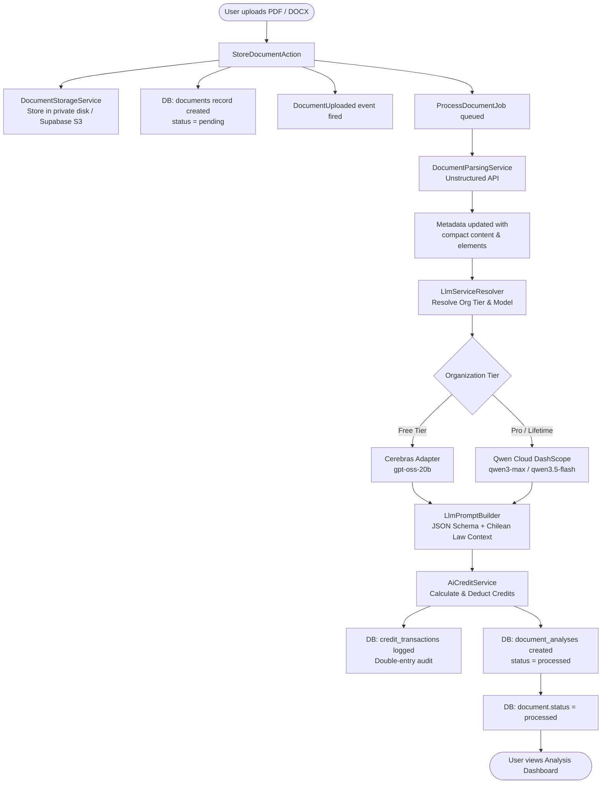
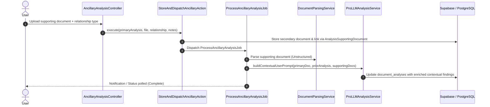
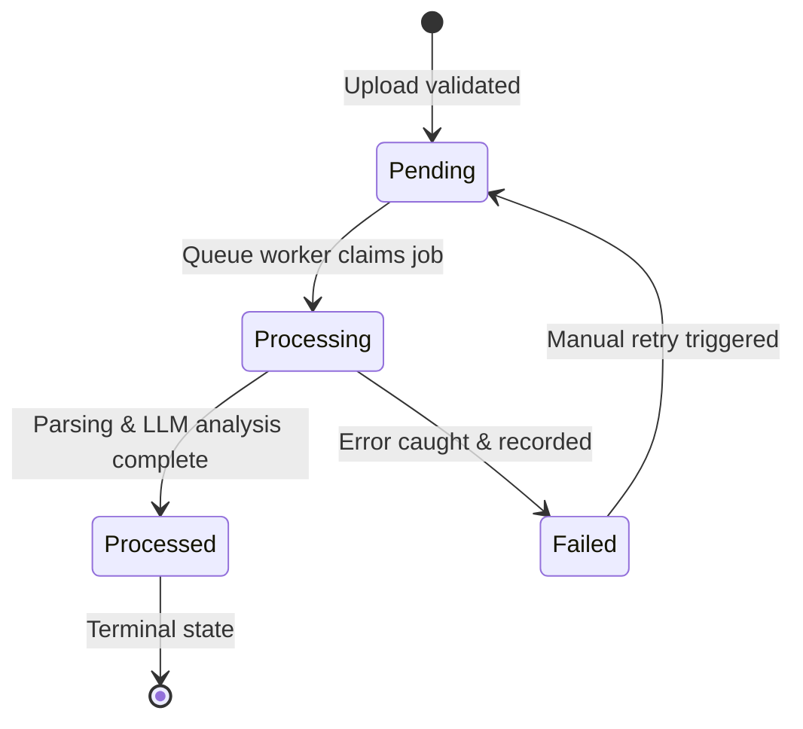
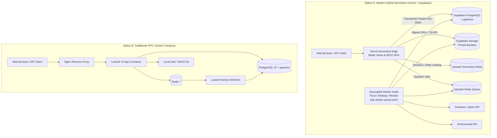

# PROJECT DEFENSE DOCUMENTATION
## Auditor-IA: AI-Powered Legal Document Analysis SaaS Platform

> **Version:** 1.2 — September 2026  
> **Repository:** AlfredoAC1/Auditor-IA  
> **Stack:** Laravel 12 · PHP 8.3 · PostgreSQL / Supabase · pgvector · Cerebras · Qwen Cloud · Groq · Unstructured API · Vercel / Docker

---

## Table of Contents

1. [Executive Summary](#1-executive-summary)
2. [Project Objectives](#2-project-objectives)
3. [Functional Description & Key Workflows](#3-functional-description--key-workflows)
4. [Technology Stack & Provider Ecosystem](#4-technology-stack--provider-ecosystem)
5. [Software Architecture](#5-software-architecture)
6. [Multi-Tenant Architecture & RBAC](#6-multi-tenant-architecture--rbac)
7. [Database Design & Entity Relationships](#7-database-design--entity-relationships)
8. [AI System & Multi-Provider Architecture](#8-ai-system--multi-provider-architecture)
9. [Responsible AI & Legal Governance](#9-responsible-ai--legal-governance)
10. [Information Security & Data Protection](#10-information-security--data-protection)
11. [Legal and Regulatory Framework (Chile)](#11-legal-and-regulatory-framework-chile)
12. [Terms and Conditions](#12-terms-and-conditions)
13. [Privacy Policy](#13-privacy-policy)
14. [Security & Compliance Mapping (OWASP / ISO 27001)](#14-security--compliance-mapping-owasp--iso-27001)
15. [Key Performance Indicators (KPIs)](#15-key-performance-indicators-kpis)
16. [SLA Proposal & Business Continuity](#16-sla-proposal--business-continuity)
17. [Observability & Health Probing](#17-observability--health-probing)
18. [Automated Testing Strategy](#18-automated-testing-strategy)
19. [Risk Management Matrix](#19-risk-management-matrix)
20. [Deployment Architecture & Cloud Strategies (Supabase & Vercel)](#20-deployment-architecture--cloud-strategies-supabase--vercel)
21. [Scalability & High Availability](#21-scalability--high-availability)
22. [Cost Analysis & Unit Economics](#22-cost-analysis--unit-economics)
23. [Product Roadmap & Future Improvements](#23-product-roadmap--future-improvements)
24. [Questions and Answers for Thesis Defense](#24-questions-and-answers-for-thesis-defense)
25. [Elevator Pitch](#25-elevator-pitch)
26. [Final Conclusions](#26-final-conclusions)

---

## 1. Executive Summary

### What Auditor-IA Is

Auditor-IA is an enterprise-grade **Software-as-a-Service (SaaS) platform** engineered to democratize access to Chilean legal document comprehension for individuals, SMEs, and legal professionals. It allows users to securely upload legal documents in PDF or DOCX format and obtain structured, AI-generated legal analyses: executive summaries, clause-by-clause breakdowns with abuse detection, risk assessments citing Chilean statutes, practical recommendations, and plain-language explanations.

The platform is built on **Laravel 12** with strict typing and modern PHP 8.3 features. It operates on **PostgreSQL** with the **pgvector** extension (compatible with **Supabase** managed infrastructure), combines ultra-fast inference via **Cerebras** (Free tier) with advanced reasoning via **Qwen Cloud (DashScope)** (Pro/Lifetime tiers), integrates the **Unstructured API** for semantic document parsing, and implements a multi-provider fallback architecture supporting Groq, NVIDIA NIM, DeepSeek, and Azure OpenAI.

### Main Problem Solved

Legal document comprehension in Chile has historically required expensive counsel or risk-prone self-interpretation. Contracts, deeds, lease agreements, and employment contracts are dense, technically drafted, and often contain clauses that are abusive under Chilean consumer protection or labor law. Auditor-IA resolves this by providing:

- **Immediate pre-reading clarity** before retaining or consulting a lawyer.
- **Automated risk flagging** referencing specific Chilean legislation (Código Civil, Código del Trabajo, Ley 19.496 de Protección al Consumidor, Ley 18.101 de Arrendamiento).
- **Contextual multi-document analysis** through supporting document attachments (annexes, amendments, addendums).
- **Substantial review cost reduction** for organizations handling frequent contract workflows.

### Target Users

| Segment | Use Case Description |
|---|---|
| Individual citizens | Reviewing lease contracts, employment agreements, consumer terms |
| SMEs & Startups | Processing vendor contracts, NDAs, service-level agreements |
| Legal aid & NGOs | Processing high volumes of client documents with limited staff |
| Corporate HR & Legal | Reviewing employment contracts, amendments, internal policies |
| Accounting & Tax firms | Analyzing legal clauses impacting financial liabilities |

### Business Model & Economic Architecture

Auditor-IA features a sustainable **AI Credit Economy**:
- **Free Tier**: Weekly regenerating credit quota, exclusively accessing fast inference via Cerebras (`gpt-oss-20b`). Automatic 7-day document pruning ensures low storage overhead.
- **Pro & Lifetime Tiers**: High monthly or lifetime credit quotas accessing tiered models (`lightweight`, `standard`, `advanced`, `premium`) powered by Qwen Cloud (`qwen3-14b`, `qwen3-max`, `qwen3.5-flash`, `qwen-3.7-flash`).
- **Flexible Deployment**: Designed to run either on traditional dedicated infrastructure (VPS / Docker Compose) or modern serverless / hybrid cloud environments combining **Vercel** (frontend & serverless APIs) and **Supabase** (managed Postgres, pgvector, and S3-compatible storage).

---

## 2. Project Objectives

### General Objective

Design, implement, validate, and document a production-ready, multi-tenant SaaS platform leveraging large language models (LLMs) and document parsing pipelines to deliver structured legal analysis grounded in Chilean legislation, enforcing strict multi-tenant isolation, auditable credit accounting, and deployment flexibility across modern cloud platforms.

### Specific Objectives

| # | Specific Objective | Implementation Evidence |
|---|---|---|
| 1 | **Secure Multi-Tenant Upload** | `DocumentStorageService`, SHA-256 integrity hashing, tenant-isolated paths `documents/{org_id}/{year}/{month}/`, UUID filenames |
| 2 | **Structured Document Parsing** | `DocumentParsingService` via Unstructured API → element classification (Title, NarrativeText, ListItem, Table) |
| 3 | **Multi-Provider AI Analysis** | `LlmServiceResolver`, `LlmAnalysisService`, `ProLLMAnalysisService`, Cerebras adapter (Free) and Qwen Cloud (Pro/Lifetime) |
| 4 | **Contextual Multi-Document Analysis** | `AnalysisSupportingDocument` model, `StoreAndDispatchAncillaryAction`, `ProcessAncillaryAnalysisJob`, contextual prompt synthesis |
| 5 | **AI Credit & Metering Economy** | `AiCreditService`, `ai_models`, `ai_credit_ledgers`, `credit_transactions` (immutable double-entry audit ledger) |
| 6 | **Role-Based Admin Oversight** | `role` column (`admin`, `user`), admin middleware, platform metrics dashboard, user CRUD, bug ticket triage |
| 7 | **Vector-Ready Data Layer (RAG)** | `LawEmbedding` model, Supabase / PostgreSQL `pgvector` extension with HNSW cosine index (`law_embeddings_embedding_idx`) |
| 8 | **Flexible Cloud Deployment** | Production readiness for both traditional containerized stacks (Docker/VPS) and hybrid serverless (Vercel + Supabase + Upstash) |

---

## 3. Functional Description & Key Workflows

### 3.1 Primary Document Upload & Analysis Workflow



### 3.2 Contextual Ancillary Analysis Workflow

Users can attach complementary documents (such as amendments, side letters, powers of attorney, or annexes) to an existing primary analysis:



### 3.3 Document Lifecycle State Machine

The `DocumentStatus` enum implements strict state transition guards preventing race conditions:



### 3.4 Available Analysis Types

| Analysis Type Enum | Spanish Label | Focus & Output Schema |
|---|---|---|
| `full_summary` | Resumen Completo | Executive overview, primary clauses, identified risks, actionable recommendations |
| `clause_analysis` | Análisis de Cláusulas | Clause-by-clause dissection, obligation balance, detection of abusive conditions |
| `risk_assessment` | Evaluación de Riesgos | Severity matrix (High/Medium/Low), Chilean statutory citations, potential liabilities |
| `recommendation` | Recomendaciones | Actionable pre-signing guidance, negotiation suggestions, required legal counsel |
| `explanation` | Explicación Simple | Plain-language synthesis for non-lawyers, stripping out obscure legalese |

---

## 4. Technology Stack & Provider Ecosystem

| Layer | Component | Implementation / Version | Purpose |
|---|---|---|---|
| **Framework** | Laravel | 12.x | Core routing, Eloquent ORM, queued jobs, policies |
| **Runtime** | PHP | 8.3+ | Strict types, enums, readonly classes, fiber support |
| **Primary Database** | PostgreSQL / Supabase | 15+ | Relational data, JSONB storage, Supavisor pooling |
| **Vector Engine** | pgvector | 0.7+ | Cosine similarity HNSW index for Chilean law RAG |
| **Web Hosting & CDN** | Vercel / Nginx | — | Serverless edge delivery, asset compression, SSL |
| **Queue / Cache** | Redis / Upstash Redis | 7.x | Asynchronous jobs, atomic rate limiting, session cache |
| **Object Storage** | Supabase Storage / S3 | S3-Compatible | Tenant-partitioned private document storage |
| **Document Parsing** | Unstructured API | Auto / Fast Strategy | PDF/DOCX decomposition into structured semantic elements |
| **Free Tier LLM** | Cerebras | `gpt-oss-20b` | Ultra-fast inference with zero cost overhead |
| **Pro Tier LLM** | Qwen Cloud | `qwen3-14b`, `qwen3-max`, `qwen3.5-flash` | High-reasoning multilingual models via DashScope API |
| **Fallback LLMs** | Groq / NVIDIA NIM / Azure | LLaMA 3.3 70B, GPT-4 | High-availability fallback & enterprise compliance |
| **Authentication** | Laravel Sanctum | 4.x | Stateful session auth & Bearer tokens for REST API |
| **Code Quality** | PHPUnit & Laravel Pint | PHPUnit 11.x, PSR-12 | Automated test suite and strict linting |

---

## 5. Software Architecture

### Architecture Pattern: Modular Monolith with Decoupled Services

Auditor-IA uses a **Modular Monolith** structure in Laravel 12. It avoids the premature network complexity of microservices while maintaining clean domain boundaries via single-action classes, DTOs, and dedicated service layers.

```
┌────────────────────────────────────────────────────────────────────────┐
│                          HTTP & PRESENTATION LAYER                     │
│  Web Routes (Blade, Tailwind/CSS)  │  API v1 Routes (Sanctum Tokens)   │
│  Controllers (Dashboard, Admin, Ancillary, Auth, BugTickets, Settings) │
├────────────────────────────────────────────────────────────────────────┤
│                         APPLICATION LAYER                              │
│  Actions (StoreDocumentAction, CreateUserAction, ResolveBugTicket, etc) │
│  DTOs (StoreDocumentDTO)  │  Form Requests  │  Policies                │
├────────────────────────────────────────────────────────────────────────┤
│                           DOMAIN SERVICES                              │
│  LlmServiceResolver  │  LlmAnalysisService  │  ProLLMAnalysisService   │
│  AiCreditService     │  DocumentParsingService │ DocumentStorageService │
│  AdminMetricsService │  ExternalServiceHealthService                   │
├────────────────────────────────────────────────────────────────────────┤
│                       INFRASTRUCTURE ADAPTERS                          │
│  Providers: CerebrasAdapter, RateLimitedAdapter, OpenAiCompatibleAdapter│
│  Storage: Local / Supabase S3 Private Bucket                           │
│  Queues: Database / Redis / Upstash Redis Queue Worker                 │
├────────────────────────────────────────────────────────────────────────┤
│                          PERSISTENCE LAYER                             │
│  Supabase / PostgreSQL 15+  │  pgvector  │  PostgreSQL UUID Aggregates │
└────────────────────────────────────────────────────────────────────────┘
```

### Service Organization & Dependency Injection

- **`LlmServiceResolver`**: Inspects organization subscription state and dynamically injects either `LlmAnalysisService` (Free / Cerebras) or `ProLLMAnalysisService` (Pro / Qwen Cloud).
- **`AiCreditService`**: Computes consumption based on token volume, applies model weight multipliers, performs atomic balance deductions, and logs immutable credit transactions.
- **`DocumentStorageService`**: Abstracts file operations across local storage, AWS S3, or Supabase Storage, guaranteeing that files are stored strictly under `documents/{organization_id}/{year}/{month}/{uuid}.{ext}`.
- **`ExternalServiceHealthService`**: Probes third-party APIs (Groq, NVIDIA NIM, Unstructured) to provide system health indicators.

---

## 6. Multi-Tenant Architecture & RBAC

### Logical Data Isolation

Auditor-IA operates on a **Shared-Database, Logical Isolation** paradigm:

1. **Foreign Key Scope**: Every tenant-owned table (`documents`, `document_analyses`, `analysis_supporting_documents`, `ai_credit_ledgers`, `credit_transactions`, `subscriptions`) includes an indexed `organization_id`.
2. **Eloquent Global Scopes**: Models implement `scopeForOrganization()` ensuring queries are restricted to the authenticated tenant.
3. **Policy Authorization**: `DocumentPolicy` inspects ownership before view, update, delete, or analysis dispatch.
4. **UUID Identifiers**: Documents, analyses, and supporting documents utilize Version 4 UUIDs, eliminating sequential ID guessing attacks.

### Role-Based Access Control (RBAC)

The `users` table contains a dedicated `role` attribute:
- **`user`**: Standard organizational member. Can upload documents, trigger analyses within tenant quotas, manage personal profile/avatar, and submit bug tickets.
- **`admin`**: System administrator. Has access to the `/admin` control center:
  - System-wide metric monitoring (total users, active orgs, storage footprint, credit consumption).
  - User management CRUD (create, update role, disable, delete).
  - Organization activation / deactivation (`ToggleOrganizationStatusAction`).
  - Cross-tenant analysis inspection for auditing and troubleshooting.
  - Bug ticket review and resolution (`AdminBugTicketController`).

---

## 7. Database Design & Entity Relationships

The schema consists of 14 interconnected Eloquent models supporting multi-tenancy, AI metering, document analysis, supporting documents, and administrative ticketing:

```mermaid
erDiagram
    ORGANIZATIONS ||--o{ USERS : "has many"
    ORGANIZATIONS ||--o{ DOCUMENTS : "owns"
    ORGANIZATIONS ||--o{ SUBSCRIPTIONS : "subscribes"
    ORGANIZATIONS ||--o{ DOCUMENT_ANALYSES : "scoped to"
    ORGANIZATIONS ||--o{ AI_CREDIT_LEDGERS : "maintains balance"
    ORGANIZATIONS ||--o{ CREDIT_TRANSACTIONS : "audited via"
    ORGANIZATIONS ||--o{ BUG_TICKETS : "submits"
    
    PLANS ||--o{ SUBSCRIPTIONS : "defines limits"
    
    USERS ||--o{ DOCUMENTS : "uploads"
    USERS ||--o{ CREDIT_TRANSACTIONS : "initiates"
    USERS ||--o{ BUG_TICKETS : "reports"
    
    DOCUMENTS ||--o{ DOCUMENT_CHUNKS : "partitioned into"
    DOCUMENTS ||--o{ DOCUMENT_ANALYSES : "evaluated by"
    DOCUMENTS ||--o{ ANALYSIS_SUPPORTING_DOCUMENTS : "attached as context"
    
    DOCUMENT_ANALYSES ||--o{ ANALYSIS_SUPPORTING_DOCUMENTS : "enriched by"
    DOCUMENT_ANALYSES ||--o{ CREDIT_TRANSACTIONS : "incurs"

    ORGANIZATIONS {
        bigint id PK
        uuid uuid UK
        string name
        string slug UK
        string tax_id
        boolean is_active
        json settings
        timestamp deleted_at
    }

    USERS {
        bigint id PK
        string name
        string email UK
        string password
        string role "admin | user"
        string avatar "path"
        bigint organization_id FK
        boolean dismissed_tutorial
        boolean dismissed_ancillary_tutorial
        timestamp email_verified_at
    }

    PLANS {
        bigint id PK
        string name
        string slug UK
        string description
        string stripe_price_id
        int max_documents_per_month
        bigint max_storage_bytes
        int ai_credits_quota
        string credit_refresh_interval "weekly | monthly"
        json allowed_model_tiers
        int price_clp
        boolean is_active
        boolean is_free
    }

    AI_MODELS {
        bigint id PK
        string slug UK
        string display_name
        string provider "cerebras | qwen_cloud | groq | nvidia_nim"
        string provider_model_id
        string tier "lightweight | standard | advanced | premium"
        decimal credit_multiplier
        int max_tokens
        boolean is_active
        int sort_order
    }

    AI_CREDIT_LEDGERS {
        bigint id PK
        bigint organization_id FK UK
        int credits_remaining
        int credits_quota
        timestamp period_started_at
        timestamp period_expires_at
        timestamp last_usage_at
    }

    CREDIT_TRANSACTIONS {
        bigint id PK
        bigint organization_id FK
        bigint user_id FK
        string type "provision | analysis_debit | refund"
        int credits_amount
        int credits_balance_after
        string model_tier
        uuid analysis_id FK
        json metadata
        timestamp created_at
    }

    DOCUMENTS {
        uuid id PK
        bigint organization_id FK
        bigint uploaded_by FK
        string original_filename
        string stored_filename
        string storage_path
        string disk
        string mime_type
        bigint file_size_bytes
        string file_hash
        string status "pending | processing | processed | failed"
        string document_type
        json metadata
        timestamp processed_at
        timestamp deleted_at
    }

    DOCUMENT_ANALYSES {
        uuid id PK
        uuid document_id FK
        bigint organization_id FK
        bigint requested_by FK
        string analysis_type
        string llm_provider
        string llm_model
        json content
        decimal confidence_score
        int input_tokens
        int output_tokens
        int processing_time_ms
        json prompt_metadata
        string status
        int version
    }

    ANALYSIS_SUPPORTING_DOCUMENTS {
        uuid id PK
        uuid analysis_id FK
        uuid document_id FK
        bigint organization_id FK
        bigint attached_by FK
        string relationship_type
        text notes
    }

    BUG_TICKETS {
        bigint id PK
        bigint user_id FK
        bigint organization_id FK
        string title
        text description
        string status "new | in_progress | resolved"
        timestamp resolved_at
        bigint resolved_by FK
    }

    LAW_EMBEDDINGS {
        uuid id PK
        string law_identifier
        string law_name
        string article_number
        text content
        vector embedding
    }
```

---

## 8. AI System & Multi-Provider Architecture

### Model Routing Matrix

| Tier | Provider | Model ID | Strategy & Optimization |
|---|---|---|---|
| **Free Tier** | **Cerebras** | `gpt-oss-20b` | High throughput, sub-second latency, zero marginal inference cost |
| **Pro (Lightweight)** | **Qwen Cloud** | `qwen3-14b` | Fast summaries, routine clause extraction |
| **Pro (Standard)** | **Qwen Cloud** | `qwen3-max` | Comprehensive clause analysis, deep risk identification |
| **Pro (Advanced)** | **Qwen Cloud** | `qwen3.5-flash` | Complex multi-document contextual analysis |
| **Pro (Premium)** | **Qwen Cloud** | `qwen-3.7-flash` | Maximum reasoning depth for critical corporate litigation |
| **Fallback / Enterprise** | **Groq** | `llama-3.3-70b-versatile` | Automated backup when Qwen/Cerebras experience upstream downtime |
| **Rate-Limited Backup** | **NVIDIA NIM** | `meta/llama-3.3-70b-instruct` | Protected via `RateLimitedAdapter` enforcing strict 40 RPM local ceiling |

### Prompt Engineering & Chilean Law Grounding

All prompts generated by `LlmPromptBuilder` and `ProLlmPromptBuilder` adhere to strict constraints:
1. **Chilean Legal Register**: Enforces Chilean Spanish legal terminology (e.g., *finiquito*, *arrendador*, *cláusula penal*, *fuerza mayor*).
2. **Statutory Anchoring**: Explicitly instructs models to cite relevant Chilean codes (Código Civil, Código del Trabajo, Ley 19.496 de Protección de los Derechos de los Consumidores).
3. **Structured JSON Output**: Models are locked into JSON mode schema formatting, avoiding unparseable prose.
4. **Mandatory Disclaimer Flag**: All schemas demand a `requiere_abogado: true` attribute.
5. **Confidence Rating**: Outputs provide a self-assessed `nivel_confianza` (`alto`, `medio`, `bajo`), which is parsed into a decimal `confidence_score` (`0.85`, `0.60`, `0.35`) in the database.

---

## 9. Responsible AI & Legal Governance

- **Human-in-the-Loop Principle**: The platform serves exclusively as an informational pre-review assistant. It explicitly states in the UI and outputs that results do not constitute formal legal counsel (*asesoría legal vinculante*).
- **Statutory Compliance (Ley 18.120)**: Under Chilean law (*Comparecencia en Juicio*), legal representation is reserved for licensed attorneys. Auditor-IA strictly avoids issuing *informes en derecho* or practicing law.
- **Zero Model Training**: Document data sent to Cerebras, Qwen Cloud (DashScope), or Groq is processed strictly in-memory per their enterprise zero-retention / zero-training API agreements.
- **Audit Traceability**: The SHA-256 hash of every system prompt, the token metrics, model identifiers, and exact timestamps are immutably captured in `prompt_metadata`.

---

## 10. Information Security & Data Protection

### Defense in Depth

```
Incoming Request
  ├── TLS 1.3 / HTTPS Encryption
  ├── Laravel Sanctum Authentication (Session / Bearer Token)
  ├── Rate Limiting Middleware (throttle:api)
  ├── RBAC & Policy Verification (DocumentPolicy, AdminMiddleware)
  ├── Form Request Validation (MIME type inspection, size limits)
  ├── Storage Isolation: documents/{org_id}/{year}/{month}/{uuid}.ext
  └── Database Scope: scopeForOrganization() applied to all queries
```

- **File Security**: Files are renamed to UUIDs upon upload; extensions are validated against an allowlist (`pdf`, `docx`); maximum size is capped at 50 MB.
- **Avatar Sanitization**: Avatars are restricted to image MIME types, stored in a private directory, and served through a controlled controller action preventing path traversal.
- **Free Document Pruning**: An automated command (`prune:free-documents`) sweeps and permanently removes free-tier documents and their parsed files older than 7 days, minimizing data liability.
- **Password Security**: Bcrypt with 12 rounds; automated session invalidation on password update; generic authentication failure messages to prevent user enumeration.

---

## 11. Legal and Regulatory Framework (Chile)

- **Ley 19.628 (Protección de la Vida Privada)**: Explicit user consent obtained during registration; strict purpose limitation; user data access and account self-deletion (`DeleteAccountAction`).
- **Ley 21.719 (Nueva Ley de Protección de Datos Personales)**: Aligns platform architecture with GDPR standards: data minimization, security breach traceability via structured logs, and right to erasure.
- **Ley 19.496 (Protección de los Derechos de los Consumidores)**: AI prompts are specifically calibrated to detect abusive clauses, unilateral contract modification clauses, and unconscionable arbitration requirements common in adhesion contracts in Chile.

---

## 12. Terms and Conditions

- **Permitted Use**: Users warrant that they possess legal authorization to upload documents for analysis.
- **Ownership**: Users retain 100% intellectual property rights and ownership over uploaded documents and derived analysis data.
- **Liability Limitation**: The platform is provided "as-is" without warranty of legal outcomes; aggregate liability is capped at subscription fees paid in the trailing 12 months.

---

## 13. Privacy Policy

- **Collected Data**: Account credentials, organizational metadata, document binaries (transient or persistent per plan tier), and billing ledger records.
- **International Transfers**: Disclosed to users that document text is transmitted via encrypted TLS to enterprise AI API endpoints (USA / International regions) solely for real-time inference.
- **Right to Erasure**: Users can trigger self-service account deletion, which cascades to delete users, avatars, personal documents, and associated analyses.

---

## 14. Security & Compliance Mapping (OWASP / ISO 27001)

| Standard / Risk Category | Mitigation in Auditor-IA |
|---|---|
| **OWASP A01 (Broken Access Control)** | Enforced via `DocumentPolicy` and `scopeForOrganization` on every Eloquent query |
| **OWASP A03 (Injection)** | Eloquent parameterized queries; strict Form Request validation |
| **OWASP LLM01 (Prompt Injection)** | Separation of system instructions and untrusted document text; JSON mode schema locking |
| **OWASP LLM04 (Denial of Service)** | Token limits per tier; `RateLimitedAdapter` enforcing 40 RPM on rate-limited endpoints |
| **OWASP LLM06 (Sensitive Info Disclosure)** | API keys confined to `.env`; document text excluded from operational log payloads |
| **ISO 27001 A.9 (Access Control)** | Sanctum token revocation, bcrypt hashing, admin role segregation |
| **ISO 27001 A.12 (Operations Security)** | Queue retry backoffs (30s, 120s, 600s), health probes via `ExternalServiceHealthService` |

---

## 15. Key Performance Indicators (KPIs)

| Metric | Target | Measurement Strategy |
|---|---|---|
| **System Uptime** | ≥ 99.5% monthly | External uptime monitoring on `/api/v1/*` and health probe endpoints |
| **Upload Processing Latency (P95)** | < 600 ms | Server-side request duration metrics |
| **End-to-End Analysis Duration (P95)** | < 45 s | `processing_time_ms` logged in `document_analyses` |
| **Queue Error Rate** | < 1.5% | Failed job count against total dispatched jobs in Redis/database |
| **Cross-Tenant Data Violations** | 0 incidents | Monitored via security test suites and automated 403 audit logs |
| **AI Credit Calculation Accuracy** | 100% | Reconciled via `credit_transactions` balance checks |

---

## 16. SLA Proposal & Business Continuity

| Plan Tier | Target Availability | Critical Incident Response (P1) | Planned Maintenance Window |
|---|---|---|---|
| **Free** | 99.0% | Best effort (24 business hours) | Anytime with notice |
| **Pro** | 99.5% | ≤ 2 hours | Off-peak (02:00 – 06:00 CLT) |
| **Lifetime** | 99.5% | ≤ 2 hours | Off-peak (02:00 – 06:00 CLT) |

- **RTO (Recovery Time Objective)**: < 2 hours for total application restoration.
- **RPO (Recovery Point Objective)**: < 1 hour using continuous WAL archiving / point-in-time recovery on Supabase.

---

## 17. Observability & Health Probing

- **Structured Monolog Logging**: Logs emit structured JSON including `document_id`, `organization_id`, `user_id`, `analysis_type`, `llm_provider`, `tokens`, and `processing_time_ms`.
- **Laravel Pail**: Real-time CLI log filtering by organization or exception during development and staging.
- **Proactive Health Checks (`ExternalServiceHealthService`)**:
  - `checkGroq()`: Validates API key and model availability.
  - `checkNvidiaNim()`: Verifies endpoint connectivity and token quotas.
  - `checkUnstructured()`: Verifies document parsing API status.

---

## 18. Automated Testing Strategy

Auditor-IA maintains a comprehensive automated test suite consisting of Feature, Security, and Unit tests executed via PHPUnit 11:

```
Total Test Suites: 20+ Files | Coverage: APIs, Admin, Security, Multi-Tenancy, Credits, Storage
```

### Key Test Categories

1. **Security & Isolation (`tests/Feature/Security/`)**:
   - `Section1CriticalPrioritiesTest.php`: Cross-tenant read/write prevention, token revocation, rate limiting.
   - `Section2MultiTenantIsolationTest.php`: Storage path isolation, UUID verification, query scoping.
   - `Section3RolesAndAuthorizationTest.php`: RBAC enforcement, privilege escalation blocks, admin restrictions.
   - `Section4MassAssignmentTest.php`: Eloquent fillable guards, DTO hydration sanitization.
   - `Section5AuthenticationAndTokenTest.php`: Password spraying protection, account lockout, hash validation.
2. **Administrative Features (`tests/Feature/Admin/`)**:
   - `AdminAccessTest.php`, `AdminMetricsTest.php`, `AdminUserManagementTest.php`: Admin CRUD and metric calculation.
3. **AI Credits & Billing (`tests/Unit/Services/AiCreditServiceTest.php`)**:
   - Weekly free-tier expiry, token-based credit calculation, overdraft protection, quota resets.
4. **Ancillary Context Analysis (`tests/Feature/AncillaryAnalysisTest.php`)**:
   - Attaching secondary documents, preventing cross-tenant document linkage, contextual re-analysis dispatch.
5. **Provider Rate Limiting (`tests/Unit/Services/LLM/Providers/RateLimitedAdapterTest.php`)**:
   - Local 40 RPM pre-request throttling and 429 response backoff.

---

## 19. Risk Management Matrix

| Identified Risk | Severity | Likelihood | Mitigation Strategy |
|---|---|---|---|
| **Upstream LLM Outage** | High | Low | Multi-provider architecture (Cerebras → Qwen Cloud → Groq → Azure fallback) |
| **Large File Parsing Timeout** | Medium | Medium | 50 MB hard limit; asynchronous queue execution with 300s job limit |
| **Credit Depletion Exploits** | High | Low | Atomic balance checks in `AiCreditService` before job execution; double-entry audit |
| **Tenant Data Cross-Contamination** | Critical | Very Low | Enforced `scopeForOrganization` on models; Policy authorization; UUIDs |
| **Legal Misinterpretation Liability** | High | Low | Mandatory `requiere_abogado: true` flag; explicit contractual liability disclaimers |

---

## 20. Deployment Architecture & Cloud Strategies (Supabase & Vercel)

Auditor-IA supports both **Modern Serverless / Hybrid Cloud** and **Traditional Containerized VPS** deployment topologies.

### 20.1 Architecture Comparison: Serverless Hybrid vs Dedicated VPS



### 20.2 Option A: Deploying with Supabase & Vercel (Recommended Hybrid Cloud)

This architecture combines the developer velocity, edge caching, and auto-scaling of **Vercel** with the managed persistence, native `pgvector`, and S3 storage of **Supabase**.

#### 1. Database & Vector Search with Supabase
- **Managed PostgreSQL 15+**: Fully compatible with Laravel's `pgsql` driver.
- **Native pgvector**: Enabled in Supabase SQL editor via `CREATE EXTENSION IF NOT EXISTS vector;`.
- **Connection Pooling (Supavisor)**: Essential for serverless architectures:
  - **Transaction Mode (`Port 6543`)**: Used by Vercel serverless HTTP requests to prevent PostgreSQL connection exhaustion during traffic spikes.
  - **Session Mode (`Port 5432`)**: Used during deployment for running schema migrations (`php artisan migrate --force`).

**Supabase Environment Configuration (`.env`):**
```dotenv
DB_CONNECTION=pgsql
DB_HOST=aws-0-us-east-1.pooler.supabase.com
DB_PORT=6543
DB_DATABASE=postgres
DB_USERNAME=postgres.your-project-ref
DB_PASSWORD=your-secure-supabase-password
DB_SSLMODE=require
```

#### 2. Private Document Storage with Supabase Storage
Supabase Storage provides S3-compatible endpoints, allowing Laravel's `DocumentStorageService` to use Flysystem's standard AWS S3 driver:

```dotenv
FILESYSTEM_DISK=s3
AWS_ACCESS_KEY_ID=your-supabase-project-ref
AWS_SECRET_ACCESS_KEY=your-supabase-service-role-key
AWS_DEFAULT_REGION=us-east-1
AWS_BUCKET=documents-private
AWS_ENDPOINT=https://your-project-ref.supabase.co/storage/v1/s3
AWS_USE_PATH_STYLE_ENDPOINT=true
```

#### 3. Web & API Hosting on Vercel
Vercel hosts the stateless HTTP layer (Blade views, user settings, authentication, REST APIs).

**Vercel Serverless Characteristics & Configuration (`vercel.json`):**
```json
{
  "version": 2,
  "framework": null,
  "functions": {
    "api/index.php": {
      "runtime": "vercel-php@0.7.2",
      "maxDuration": 30
    }
  },
  "routes": [
    {
      "src": "/build/(.*)",
      "dest": "/public/build/$1"
    },
    {
      "src": "/(.*)",
      "dest": "/api/index.php"
    }
  ],
  "env": {
    "APP_ENV": "production",
    "APP_DEBUG": "false",
    "APP_CONFIG_CACHE": "/tmp/config.php",
    "APP_EVENTS_CACHE": "/tmp/events.php",
    "APP_PACKAGES_CACHE": "/tmp/packages.php",
    "APP_ROUTES_CACHE": "/tmp/routes.php",
    "APP_SERVICES_CACHE": "/tmp/services.php",
    "VIEW_COMPILED_PATH": "/tmp"
  }
}
```

#### 4. The Queue Worker Dilemma in Serverless & The Decoupled Worker Solution
> [!IMPORTANT]
> **Vercel Serverless Function Limit**: Vercel serverless functions are event-driven with strict execution limits (15s on Hobby, up to 300s on Pro). They **cannot run long-running background daemon processes** (`php artisan queue:work` or `php artisan horizon`).
>
> In Auditor-IA, parsing large PDFs via Unstructured and running high-token legal analysis through Cerebras/Qwen can require 30 to 90 seconds. Attempting to process these synchronously in a Vercel HTTP function risks HTTP 504 Gateway Timeouts.

**The Solution: Decoupled Queue Worker Pattern**
1. **HTTP Ingestion on Vercel**: User uploads document → `StoreDocumentAction` stores file in Supabase Storage → writes `pending` record in Supabase Postgres → dispatches `ProcessDocumentJob` to an external **Upstash Redis Queue**. Vercel immediately returns a `201 Created` response.
2. **Decoupled Worker Daemon**: A lightweight container running on **Fly.io**, **Railway**, or **Render** ($5/month) runs:
   ```bash
   php artisan queue:work redis --queue=documents,analysis,default --tries=3 --timeout=300
   ```
3. **Status Polling**: The frontend on Vercel polls `/dashboard/documents/{id}/status`, reading real-time progress from Supabase Postgres updated by the worker.

### 20.3 Deployment Option Comparison Matrix

| Feature / Dimension | Hybrid Serverless (Vercel + Supabase) | Managed PaaS (Railway / Render) | VPS / Docker (Coolify / Hetzner) |
|---|---|---|---|
| **Setup Complexity** | Low to Medium | Low | Medium to High |
| **Cold Starts** | Minimal (edge static, warm PHP) | None (always-on) | None |
| **Database Maintenance** | Zero (Supabase automated backups, HA) | Zero (Managed DB) | High (Manual pg_dump, updates) |
| **Vector Engine (pgvector)** | 1-Click Native Extension | Requires custom Docker image | Manual compilation / Docker |
| **Queue Worker Handling** | Requires decoupled worker node | Native background worker service | Native systemd / Docker daemon |
| **Monthly Entry Cost** | ~$0 – $30 USD | ~$15 – $40 USD | ~$6 – $20 USD |

---

## 21. Scalability & High Availability

1. **Stateless Web Nodes**: Neither Vercel serverless instances nor Docker containers store session or binary data locally. User avatars and uploaded legal documents reside in S3 / Supabase Storage; sessions reside in Redis.
2. **Connection Pooling with Supavisor**: Enables thousands of concurrent Vercel serverless invocations to share a bounded pool of PostgreSQL connections without hitting Postgres connection limits.
3. **Queue Segmentation**: Jobs are partitioned into discrete queues (`documents` for parsing, `analysis` for LLM inference, `default` for emails/notifications), allowing worker nodes to scale independently based on bottleneck type.
4. **Automated Free Document Pruning**: Keeps storage footprint predictable and compliant by removing inactive free-tier files after 7 days.

---

## 22. Cost Analysis & Unit Economics

### 22.1 Infrastructure Cost Projections (Monthly)

| Service Component | Free / Dev Tier | Growth Scale (1,000 Orgs) | Enterprise Scale (10,000 Orgs) |
|---|---|---|---|
| **Web & API (Vercel)** | $0 (Hobby) | $20 / mo (Pro 1 Seat) | $150 / mo (Enterprise/Seats) |
| **Database & Vector (Supabase)** | $0 (Free Tier) | $25 / mo (Pro Tier + Compute) | $250 / mo (Compute XL + Replicas) |
| **Object Storage (Supabase Storage)** | $0 (Included 1 GB) | $15 / mo (~150 GB) | $120 / mo (~1.5 TB) |
| **Cache & Queue (Upstash Redis)** | $0 (Free Tier) | $10 / mo (Pay-as-you-go) | $80 / mo (Dedicated Cluster) |
| **Queue Worker Node (Fly.io / Railway)** | $0 (Local) | $10 / mo (2x 1GB Worker) | $75 / mo (Autoscaled Workers) |
| **AI Inference (Cerebras - Free Tier)** | $0 (Free Allowance) | $15 / mo (~15M tokens) | $90 / mo (~90M tokens) |
| **AI Inference (Qwen Cloud - Pro Tier)** | $0 | $120 / mo (DashScope API) | $950 / mo (DashScope API) |
| **Document Parsing (Unstructured API)** | $0 (Free Allowance) | $140 / mo | $850 / mo |
| **Total Estimated Monthly Cost** | **$0 / mo** | **~$355 / mo** | **~$2,565 / mo** |

### 22.2 Unit Economics

- **Average Cost per Document Analysis**:
  - Free Tier (Cerebras + Unstructured): ~$0.006 USD
  - Pro Tier (Qwen Cloud `qwen3-max` + Unstructured): ~$0.022 USD
- **Pro Tier Subscription Price**: ~$19,900 CLP (~$21 USD / month for 1,000 AI Credits).
- **Gross Profit Margin**: **> 82%** at conservative utilization rates.

---

## 23. Product Roadmap & Future Improvements

### Completed in Current Architecture
- [x] Multi-tenant document upload and private storage isolation.
- [x] Semantic document decomposition via Unstructured API.
- [x] Multi-tier AI routing (Cerebras for Free, Qwen Cloud DashScope for Pro/Lifetime).
- [x] Multi-provider fallback adapters (Groq, NVIDIA NIM with 40 RPM rate limiting, DeepSeek, Azure).
- [x] Contextual ancillary analysis: attaching supporting documents to existing analyses.
- [x] AI Credit Economy with double-entry immutable transaction logging.
- [x] Full Administrative Dashboard, User CRUD, and Bug Ticket resolution system.
- [x] Account profile customization, secure avatar upload, and user self-deletion.
- [x] Automated 7-day pruning of free-tier documents.

### Future Roadmap
1. **Phase 2: RAG Pipeline Activation**
   - Populate `law_embeddings` with the complete corpus of Chilean statutory codes (Código Civil, Código de Comercio, Código del Trabajo, Ley 19.496).
   - Implement HNSW vector similarity queries against `law_embeddings` using `pgvector` before constructing LLM prompts.
2. **Phase 3: Automated Audit Certificate Generation**
   - PDF rendering engine generating branded, digitally signed legal audit certificates summarizing contract risks.
3. **Phase 4: Enterprise SSO & Integration Hub**
   - SAML / Okta / Azure AD Single Sign-On for corporate enterprise tiers.
   - Webhook dispatchers notifying external ERPs (SAP, NetSuite) of contract approval statuses.

---

## 24. Questions and Answers for Thesis Defense

### Q1: How does Auditor-IA accommodate serverless hosting environments like Vercel given Laravel's reliance on daemonized queue workers?
> **Answer**: Serverless platforms like Vercel excel at stateless HTTP request execution and global CDN delivery, but cannot run persistent daemons like `queue:work` due to execution timeouts. Auditor-IA resolves this through a **Decoupled Worker Architecture**: Vercel handles all web and API routes, writes metadata to Supabase Postgres, and queues background jobs to an external Redis broker (Upstash). A lightweight container worker running on Fly.io, Railway, or Docker executes the long-running PDF parsing and AI analysis jobs independently. The user interface polls the job status via Vercel without risking HTTP gateway timeouts.

### Q2: Why choose Supabase instead of running a self-managed PostgreSQL instance on a standard VPS?
> **Answer**: Supabase delivers three critical production advantages:
> 1. **Native `pgvector` Support**: Fully integrated and managed, avoiding the operational complexity of compiling and maintaining the C-based `pgvector` extension across OS updates.
> 2. **Built-in Connection Pooling (Supavisor)**: Essential for serverless and high-concurrency environments, allowing thousands of ephemeral client connections on port 6543 without exhausting PostgreSQL connection limits.
> 3. **Integrated S3 Storage & Automated Disaster Recovery**: Provides an S3-compatible private storage API with built-in daily backups, Point-in-Time Recovery (PITR), and high availability with zero manual server maintenance.

### Q3: How does the AI Credit system prevent financial loss or API credit exhaustion from abusive users?
> **Answer**: The system uses a multi-layered metering model managed by `AiCreditService`:
> 1. **Model Multipliers & Dynamic Token Cost**: Models are cataloged in `ai_models` with tiers (`lightweight`, `standard`, `advanced`, `premium`) and credit multipliers. Credit cost is dynamically computed based on actual input/output token usage.
> 2. **Atomic Pre-Execution Quota Checks**: Before queuing an analysis, the system verifies available balance in `ai_credit_ledgers`. If credits are insufficient, the request is rejected with a `402 Payment Required` exception.
> 3. **Immutable Audit Ledger**: Every credit grant or deduction writes an immutable record to `credit_transactions`, tracking user ID, model used, tokens consumed, and balance snapshots.
> 4. **Tier Segregation**: Free users are programmatically restricted to the Cerebras adapter, keeping marginal inference costs near zero.

### Q4: How does Contextual Ancillary Analysis work without causing prompt token overflow?
> **Answer**: Rather than appending entire unparsed documents, `StoreAndDispatchAncillaryAction` processes the supporting document through Unstructured to extract only dense, high-signal semantic text (`compact_content`). `LlmPromptBuilder` synthesizes the original document summary, prior key findings, and the supporting document's relevant sections into a cohesive prompt. This preserves legal context while remaining strictly within the LLM's token budget.

### Q5: How do you address the legal risk of "Ejercicio Ilegal de la Profesión" under Chilean Law 18.120?
> **Answer**: Under Chilean legislation, issuing binding legal opinions or providing legal defense requires a licensed attorney. Auditor-IA is strictly positioned as an informational legal intelligence tool:
> - Every JSON response schema requires `requiere_abogado: true`.
> - Confidence levels (`alto`, `medio`, `bajo`) and limitations are highlighted in the UI.
> - The Terms of Service state that the platform provides informational pre-reading assistance and does not establish an attorney-client relationship.

---

## 25. Elevator Pitch

> "Auditor-IA transforms how individuals, businesses, and legal teams in Chile navigate complex legal documents. By combining high-speed semantic document parsing with state-of-the-art language models grounded in Chilean legislation, Auditor-IA dissects dense contracts into plain-language summaries, clause-by-clause assessments, and statutory risk flags in under a minute. Built on a multi-tenant, enterprise-ready Laravel 12 architecture supporting both traditional Docker and modern serverless deployments via Supabase and Vercel, Auditor-IA empowers non-lawyers to negotiate with confidence while slashing legal review costs by over 80%."

---

## 26. Final Conclusions

1. **Production-Ready Architecture**: Auditor-IA proves that a modern Laravel 12 application with strict typing, clean single-action classes, DTOs, and dedicated service resolvers can reliably power complex, asynchronous AI document pipelines.
2. **Chilean Legal Specialization**: Prompts tailored specifically to Chilean statutes (Código Civil, Código del Trabajo, Ley 19.496) and structured JSON output mode eliminate generic advice in favor of actionable legal intelligence.
3. **Cloud & Deployment Flexibility**: The architecture is fully prepared for modern cloud topologies, allowing seamless deployment via **Supabase** (Postgres + pgvector + S3 storage) and **Vercel** (serverless edge execution) alongside decoupled background workers.
4. **Economic & Multi-Tenant Security**: With tenant-isolated file paths, strict Eloquent scoping, RBAC administrative controls, and an immutable AI credit ledger, the platform satisfies both rigorous academic defense standards and commercial SaaS viability.