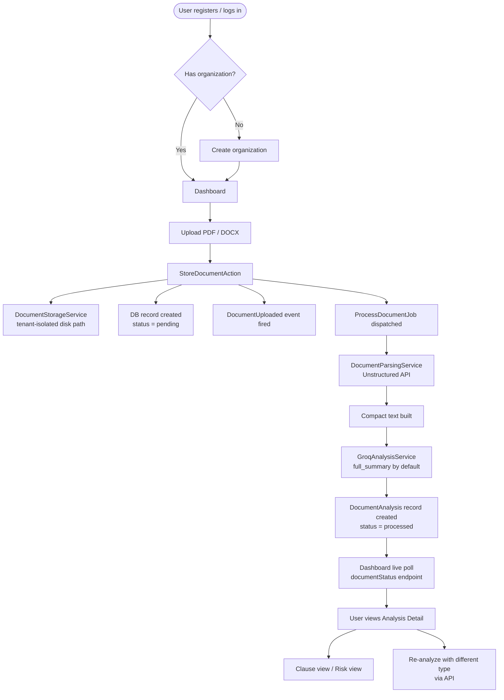
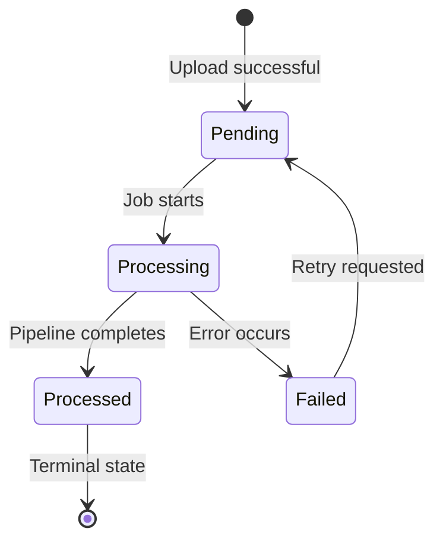
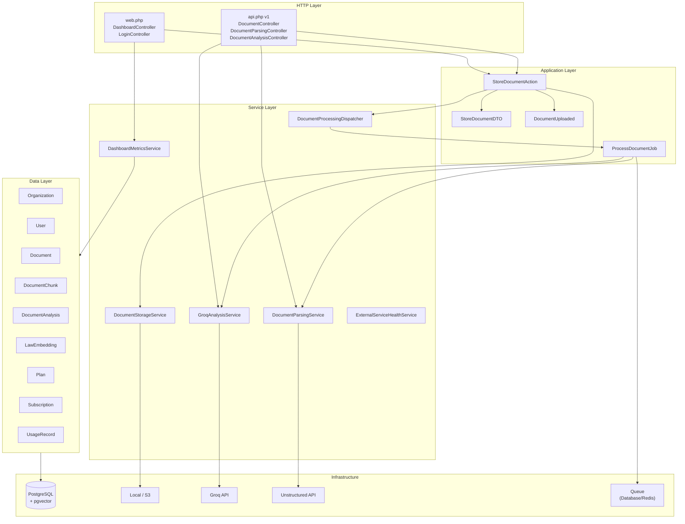
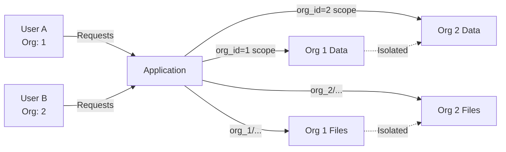
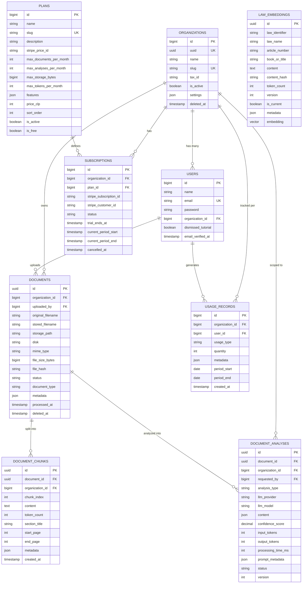
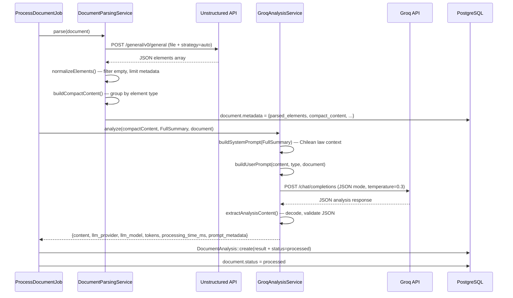
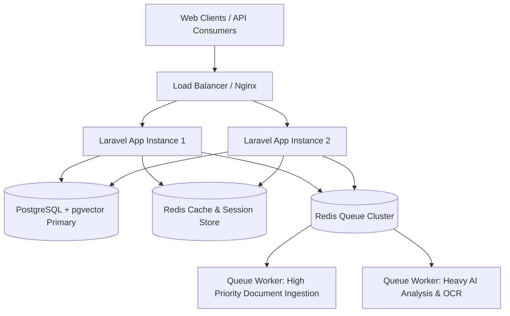
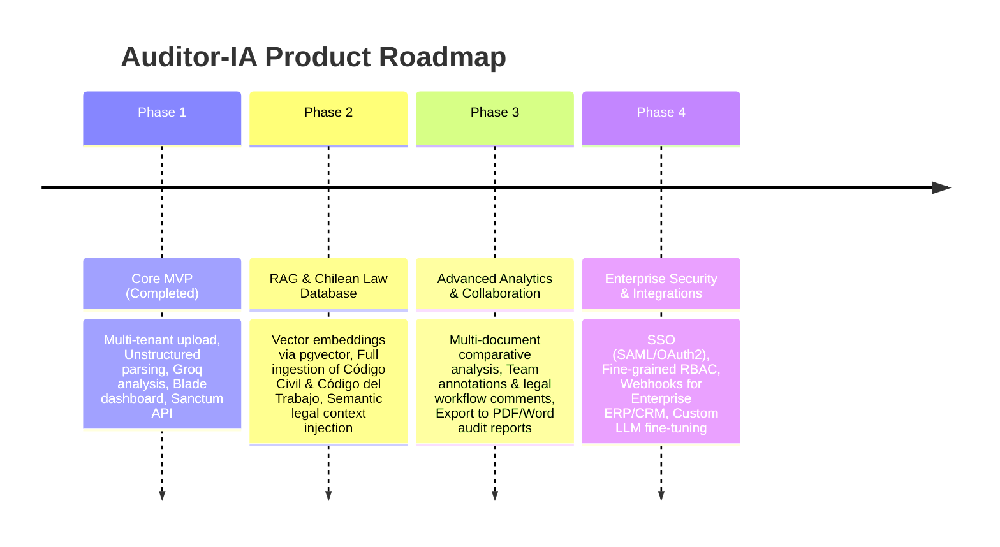

# PROJECT DEFENSE DOCUMENTATION
## Auditor-IA: AI-Powered Legal Document Analysis SaaS Platform

> **Version:** 1.0 — August 2026
> **Repository:** AlfredoAC1/Auditor-IA
> **Stack:** Laravel 12 · PHP 8.3 · PostgreSQL · pgvector · Groq (LLaMA / Qwen) · Unstructured API

---

## Table of Contents

1. [Executive Summary](#1-executive-summary)
2. [Project Objectives](#2-project-objectives)
3. [Functional Description](#3-functional-description)
4. [Technology Stack](#4-technology-stack)
5. [Software Architecture](#5-software-architecture)
6. [Multi-Tenant Architecture](#6-multi-tenant-architecture)
7. [Database Design](#7-database-design)
8. [AI System Description](#8-ai-system-description)
9. [Responsible AI](#9-responsible-ai)
10. [Information Security](#10-information-security)
11. [Legal and Regulatory Framework](#11-legal-and-regulatory-framework)
12. [Terms and Conditions](#12-terms-and-conditions)
13. [Privacy Policy](#13-privacy-policy)
14. [Compliance Mapping](#14-compliance-mapping)
15. [KPIs](#15-kpis)
16. [SLA Proposal](#16-sla-proposal)
17. [Observability](#17-observability)
18. [Testing Strategy](#18-testing-strategy)
19. [Risks](#19-risks)
20. [Scalability](#20-scalability)
21. [Cost Analysis](#21-cost-analysis)
22. [Future Improvements](#22-future-improvements)
23. [Questions and Answers for Thesis Defense](#23-questions-and-answers-for-thesis-defense)
24. [Elevator Pitch](#24-elevator-pitch)
25. [Final Conclusions](#25-final-conclusions)

---

## 1. Executive Summary

### What Auditor-IA Is

Auditor-IA is a **Software-as-a-Service (SaaS) platform** designed to democratize access to basic legal document comprehension for individuals and organizations in Chile. It enables non-specialist users to upload legal documents in PDF or DOCX format and receive structured AI-generated analysis covering: general summaries, clause-by-clause breakdowns, risk assessments, practical recommendations, and plain-language explanations — all grounded in Chilean legislation.

The platform is built on **Laravel 12**, uses **PostgreSQL** with the **pgvector** extension for future vector similarity search, integrates the **Groq API** (running Qwen3-32B / LLaMA-3.3-70B) for LLM-driven analysis, and the **Unstructured API** for robust document parsing (PDF/DOCX → structured JSON). It follows a **multi-tenant architecture** where each subscribing organization is logically isolated from all others, ensuring document confidentiality at both the application and filesystem levels.

### Main Problem Solved

Legal document comprehension in Chile — and Latin America broadly — has historically required either expensive legal counsel or risk-prone self-interpretation. Contracts, employment agreements, lease agreements, court filings, and notarial deeds are dense, technically written, and can contain clauses that are harmful, abusive under consumer protection law, or simply misunderstood by signatories. Auditor-IA bridges this gap by providing:

- **Immediate pre-reading clarity** before consulting a lawyer
- **Risk flagging** referencing specific Chilean laws (Código Civil, Código del Trabajo, Ley del Consumidor)
- **Cost reduction** for organizations that must process large volumes of contracts

### Target Users

| Segment | Description |
|---|---|
| Individual citizens | Reviewing rental agreements, employment contracts, service agreements |
| SMEs and startups | Processing supplier contracts, NDA agreements, service terms |
| Legal aid organizations | Processing high volumes of documents with limited staff |
| HR departments | Reviewing employment contract templates and amendments |
| Accounting and tax firms | Reviewing financial and tax document implications |

### Business Value

- **Freemium SaaS model** with tiered pricing in CLP (Free / Pro / Lifetime)
- Reduces legal review time from hours to minutes for routine documents
- Provides an auditable, traceable record of all document analyses
- Eliminates reliance on a single LLM provider through a multi-provider config architecture (Groq, DeepSeek, Azure OpenAI)

### Legal Value

The platform makes explicit that **it assists legal analysis but never replaces qualified legal professionals**. Every AI analysis output includes a `requiere_abogado: true` flag and a `nivel_confianza` (confidence level) indicator, enforcing human-in-the-loop responsibility.

### Competitive Advantages

1. **Chilean legal specialization** — prompts are tuned to Chilean legislation, not generic law
2. **Multi-provider AI resilience** — not locked to a single LLM vendor
3. **Full audit trail** — every analysis stores the model, tokens used, prompt hash, and confidence score
4. **Tenant-isolated document storage** — files stored under `documents/{org_id}/{year}/{month}/`
5. **State machine document lifecycle** — prevents invalid status transitions
6. **Production-grade architecture** — strict typing, DTOs, Actions, Policies, Form Requests, Events

---

## 2. Project Objectives

### General Objective

Design, develop, and validate a multi-tenant SaaS platform that leverages large language models (LLMs) and document parsing APIs to provide structured legal document analysis grounded in Chilean legislation, making legal comprehension accessible to non-specialist users.

### Specific Objectives

| # | Objective | Implementation Evidence |
|---|---|---|
| 1 | Implement secure multi-tenant document upload | `DocumentStorageService` with tenant-path isolation, SHA-256 hash, UUID filenames |
| 2 | Parse PDF/DOCX into structured LLM-ready content | `DocumentParsingService` → Unstructured API |
| 3 | Generate structured AI analysis by document type | `GroqAnalysisService` with 5 analysis types and JSON-mode responses |
| 4 | Enforce tenant data isolation at all layers | `scopeForOrganization()` on all models, `DocumentPolicy`, organization_id on all tables |
| 5 | Provide SaaS billing model | `Plan`, `Subscription`, `UsageRecord` models; Stripe-ready config |
| 6 | Design for future RAG integration | `LawEmbedding` model, pgvector extension, embeddings config |
| 7 | Build production-ready, testable architecture | Actions, DTOs, Services, Jobs, Enums, Policies, PHPUnit feature tests |
| 8 | Ensure full auditability of AI outputs | `prompt_metadata` (SHA-256 prompt hash), `llm_model`, `confidence_score`, `version` stored per analysis |

---

## 3. Functional Description

### User Workflow



### Document Status State Machine

The `DocumentStatus` enum enforces a strict finite-state machine with explicit allowed transitions:



This prevents race conditions and invalid state mutations in concurrent processing scenarios.

### Analysis Types Available

| Enum Value | Spanish Label | Description |
|---|---|---|
| `full_summary` | Resumen Completo | Full analysis: summary, clauses, risks, recommendations |
| `clause_analysis` | Análisis de Cláusulas | Clause-by-clause breakdown with abuse detection |
| `risk_assessment` | Evaluación de Riesgos | Risk identification with severity and legal references |
| `recommendation` | Recomendaciones | Actionable recommendations with Chilean law citations |
| `explanation` | Explicación Simple | Plain-language explanation for non-legal audiences |

### Document Types Supported

The `DocumentType` enum covers 14 categories of Chilean legal documents:

- Contracts, Amendments, Lease Agreements, Employment Contracts
- Notarial Deeds, Powers of Attorney, Affidavits
- Administrative, Financial, Invoice, Tax Documents
- Court Filings, Legal Opinions, Other

---

## 4. Technology Stack

| Layer | Technology | Version | Purpose |
|---|---|---|---|
| **Backend Framework** | Laravel | 12.x | Application core, routing, ORM, queues |
| **Language** | PHP | 8.3+ | Strict typing, enums, readonly properties, fibers |
| **Primary Database** | PostgreSQL | 15+ | Relational data, JSON columns, full-text search |
| **Vector Extension** | pgvector | 0.7+ | Cosine-similarity search for RAG (future) |
| **Authentication** | Laravel Sanctum | 4.x | Token-based API auth + session auth for SPA |
| **AI / LLM** | Groq API | — | LLaMA 3.3 70B / Qwen3-32B inference, JSON mode |
| **Document Parsing** | Unstructured API | — | PDF/DOCX → structured JSON elements |
| **Queue Driver** | Database / Redis | — | Async document processing jobs |
| **Cache** | File / Redis | — | Config and session caching |
| **Storage** | Local / S3-compatible | — | Tenant-isolated document storage |
| **Billing** | Stripe | — | Subscription management (configured, not yet activated) |
| **Embeddings** | OpenAI text-embedding-3-small | — | 1536-dim vectors for law articles (future) |
| **Frontend** | Blade + Vite | — | Server-rendered views with asset bundling |
| **Testing** | PHPUnit | 11.x | Feature and unit tests |
| **Code Style** | Laravel Pint | 1.x | PSR-12 enforcement |
| **Dev Tooling** | Laravel Sail, Pail | — | Docker dev environment, real-time log viewer |

### Technology Justification

**Why Laravel 12?** Laravel provides a mature, battle-tested ecosystem with built-in support for queues, events, policies, Sanctum authentication, and ORM with scopes — all essential for a multi-tenant SaaS. Laravel 12 adds improved routing performance and PHP 8.3 compatibility.

**Why PostgreSQL + pgvector?** PostgreSQL's JSON support is essential for storing heterogeneous document metadata and analysis results. pgvector adds native cosine-similarity search for the planned RAG pipeline, avoiding the need for an external vector store (Pinecone, Weaviate) in early stages.

**Why Groq?** Groq provides near-zero-latency inference on open models (LLaMA, Qwen) with JSON mode support, making it ideal for development and initial production. The architecture is designed for provider swapping via `config/llm.php`.

**Why Unstructured?** Unstructured converts PDF/DOCX into semantically typed JSON elements (Title, NarrativeText, Table, ListItem) rather than raw text, producing more token-efficient and context-rich input for LLM analysis.

---

## 5. Software Architecture

### Architecture Style: Modular Monolith

Auditor-IA follows a **Modular Monolith** pattern — a single deployable Laravel application with clear internal domain separation. This choice is justified because:

1. The team is small (early-stage SaaS)
2. Inter-domain communication overhead of microservices is unjustified at this scale
3. Domain boundaries are well-defined and can be extracted to microservices when load demands it

### Layered Architecture

```
┌────────────────────────────────────────────────────────┐
│                    HTTP Layer                          │
│  Routes (web.php / api.php) → Controllers → Requests   │
├────────────────────────────────────────────────────────┤
│                 Application Layer                       │
│         Actions · DTOs · Events · Jobs                  │
├────────────────────────────────────────────────────────┤
│                  Domain / Service Layer                 │
│   DocumentStorageService · DocumentParsingService      │
│   GroqAnalysisService · DashboardMetricsService         │
│   DocumentProcessingDispatcher                         │
├────────────────────────────────────────────────────────┤
│                  Data / Model Layer                     │
│   Eloquent Models · Enums · Scopes · Policies          │
├────────────────────────────────────────────────────────┤
│               Infrastructure Layer                     │
│   PostgreSQL · Redis · S3/Local · Groq API             │
│   Unstructured API · Stripe                            │
└────────────────────────────────────────────────────────┘
```

### Component Diagram



### Key Architectural Patterns

| Pattern | Where Used | Justification |
|---|---|---|
| **Action** | `StoreDocumentAction` | Single-responsibility orchestration, no logic in controllers |
| **DTO** | `StoreDocumentDTO` | Decouples HTTP layer from business logic, type safety |
| **Service** | `DocumentParsingService`, `GroqAnalysisService` | Encapsulates external API communication |
| **Job** | `ProcessDocumentJob` | Async processing with retry backoff and failure handling |
| **Event** | `DocumentUploaded` | Decoupled notifications, audit hooks, analytics |
| **Policy** | `DocumentPolicy` | Authorization centralized, tenant isolation enforced |
| **Enum** | `DocumentStatus`, `AnalysisType`, etc. | Type safety for state values, prevents invalid strings |
| **Scope** | `scopeForOrganization()` | Query-level tenant isolation, prevents cross-tenant leaks |
| **State Machine** | `DocumentStatus::allowedTransitions()` | Prevents invalid status mutations |

---

## 6. Multi-Tenant Architecture

### Tenant Isolation Strategy: Shared Database, Logical Isolation

Auditor-IA uses a **shared-database, shared-schema** multi-tenancy model where tenant isolation is enforced through:

1. `organization_id` foreign key on every tenant-scoped table
2. Query scopes (`scopeForOrganization`) that must be applied at every data access point
3. `DocumentPolicy` authorization checks on every API endpoint
4. Filesystem path partitioning: `documents/{organization_id}/{year}/{month}/`

### Tenant Identification

Each `User` belongs to exactly one `Organization`. The `organization_id` is resolved from the authenticated user at the controller layer and propagated through DTOs and Actions — never sourced from untrusted user input.

```php
// StoreDocumentDTO - organization_id from authenticated user, not from request body
$dto = new StoreDocumentDTO(
    file: $request->file('file'),
    organizationId: (int) $user->organization_id,  // from auth, not input
    uploadedBy: (int) $user->id,
);
```

### Security Boundaries



### Threat Analysis

| Threat | Mechanism | Mitigation |
|---|---|---|
| Cross-tenant data access via direct ID | User guesses another org's document UUID | `DocumentPolicy::view()` checks `belongsToOrganization()` |
| Tenant enumeration via sequential IDs | Predictable integer IDs on documents | Documents use UUID primary keys |
| File path traversal | Attacker manipulates storage path | UUIDs as filenames, extension validated against allowlist |
| Cross-tenant file access | Direct S3/disk URL guessing | Files on private disk, never public URLs |
| Query injection bypassing tenant scope | Missing `forOrganization` scope | Enforced by Policy before any query runs |
| Duplicate upload detection | Same file uploaded by different org | SHA-256 hash indexed per `(file_hash, organization_id)` |

### Multi-Tenant Models

All tenant-scoped tables include `organization_id` and expose `scopeForOrganization()`:

- `documents` — organization_id + composite indexes
- `document_analyses` — organization_id (defense in depth: document_id already implies org)
- `document_chunks` — organization_id
- `usage_records` — organization_id
- `subscriptions` — organization_id

### Defense in Depth

The `DocumentAnalysisController::show()` method performs a secondary check beyond the Policy:

```php
// Verify analysis belongs to this document (defense in depth)
if ($analysis->document_id !== $document->id) {
    return response()->json(['error' => 'not_found'], 404);
}
```

This ensures that even if the Policy passes (user owns the document), the analysis must actually belong to that document — preventing cross-analysis leakage.

---

## 7. Database Design

### Entity Relationship Diagram



### Key Design Decisions

| Decision | Justification |
|---|---|
| UUID primary keys on documents | Prevents sequential ID enumeration, safe to expose in URLs |
| `SoftDeletes` on Organization, Document | Complies with data retention requirements; recoverable |
| `file_hash` (SHA-256) indexed | Enables duplicate detection within a tenant's documents |
| `metadata` JSONB column on Document | Stores parsed Unstructured elements, compact content, errors — avoids schema changes for evolving pipeline |
| `prompt_metadata` on DocumentAnalysis | Full auditability: SHA-256 of prompt, model name, temperature, analysis type |
| `version` on DocumentAnalysis | Allows re-analysis without destroying prior results |
| `confidence_score` (decimal 3,2) | Quantifiable AI output quality metric, mapped from LLM's own `nivel_confianza` |
| pgvector `embedding vector(1536)` on LawEmbedding | HNSW index for sub-millisecond cosine similarity search |
| Composite indexes `(org_id, status)`, `(org_id, created_at)` | Efficient tenant-scoped queries at scale |

### Performance Indexes

```sql
-- Documents table
INDEX (organization_id, status)
INDEX (organization_id, created_at)
INDEX (file_hash, organization_id)
INDEX (uploaded_by)

-- Document analyses table
INDEX (document_id, analysis_type)
INDEX (organization_id, created_at)
INDEX (organization_id, status)

-- Law embeddings — vector similarity
INDEX law_embeddings_embedding_idx USING hnsw (embedding vector_cosine_ops)
```

---

## 8. AI System Description

### AI Provider and Models

| Provider | Model | Role | Status |
|---|---|---|---|
| Groq | qwen/qwen3-32b (current) | Primary legal analysis LLM | Active |
| Groq | llama-3.3-70b-versatile (default config) | Fallback legal analysis LLM | Configured |
| OpenAI | text-embedding-3-small | Document chunk embeddings (RAG) | Configured, not yet active |
| DeepSeek | deepseek-chat | Production LLM alternative | Configured |
| Azure OpenAI | GPT-4 deployment | Enterprise LLM alternative | Configured |
| Unstructured | Auto strategy | PDF/DOCX → structured JSON | Active |

### Document Processing Pipeline



### Prompt Engineering

**System Prompt Structure:**

Every system prompt contains two layers:

1. **Base context** — Establishes the assistant's role as a Chilean legal specialist. Contains explicit rules:
   - Always respond in Chilean Spanish
   - Reference specific Chilean laws (Código Civil, Código del Trabajo, Ley del Consumidor)
   - Never invent laws or articles
   - Always recommend consulting a lawyer for important decisions
   - Flag potentially abusive clauses under Chilean consumer protection law

2. **Analysis-type-specific instructions** — Each of the 5 analysis types receives a unique JSON schema definition that the model must comply with (using Groq's `json_object` response format).

**Temperature = 0.3 (by default):** This low temperature setting is intentional for legal analysis — it reduces creative hallucination while preserving nuanced legal reasoning. Higher temperatures would increase variability inappropriate for legal contexts.

**System Prompt Hashing:** The SHA-256 hash of the system prompt is stored in `prompt_metadata.system_prompt_hash` for every analysis. This enables:
- Detection if a prompt was modified between analyses
- Audit trail linking outputs to exact prompt versions
- Reproducibility verification

### Structured Output Enforcement

The Groq call enforces `response_format: {type: json_object}`, which causes the model to always return valid JSON. If the model returns invalid JSON despite this (edge case), the service wraps the raw text in a `{raw_response, parse_error}` envelope rather than throwing an exception — graceful degradation.

### Hallucination Mitigation

| Technique | Implementation |
|---|---|
| **Grounding in document text** | User prompt contains the actual document content, not just a question |
| **Explicit prohibition** | System prompt: "NO inventes leyes ni artículos que no existan" |
| **Uncertainty declaration** | System prompt: "Si no tienes certeza, indícalo explícitamente" |
| **Confidence self-reporting** | Model outputs `nivel_confianza: alto/medio/bajo` |
| **JSON schema enforcement** | JSON mode prevents free-form narrative that hides unreliable claims |
| **Lawyer recommendation** | Every analysis type includes `requiere_abogado: true` field |
| **Low temperature** | 0.3 reduces creative drift while preserving reasoning |

### RAG Architecture (Designed, Not Yet Active)

The database already contains the `law_embeddings` table with pgvector HNSW index, designed for the following future RAG flow:

1. Chilean law articles pre-processed into 500-token chunks
2. Each chunk embedded with OpenAI `text-embedding-3-small` → 1536-dimensional vector
3. At analysis time: document query vector compared against law embeddings via cosine similarity
4. Top-k matching law articles injected into the system prompt as grounding context

This design means the future RAG integration requires only adding an embedding generation step and modifying the system prompt builder — no database schema changes needed.

### AI Limitations

- The model does not have access to real-time Chilean legislation updates
- Analysis quality depends on Unstructured API parsing accuracy (handwritten documents may fail)
- Large documents may exceed token limits and be truncated
- Spanish language quality may vary across document dialects (legal vs. colloquial)
- The model cannot verify digital signatures or document authenticity

---

## 9. Responsible AI

### Transparency

Auditor-IA is transparent about its AI nature at every touchpoint:

- Every analysis record stores the `llm_provider` and `llm_model` that generated it
- The `prompt_metadata.system_prompt_hash` allows verification that the same prompt was used
- The `confidence_score` and `nivel_confianza` are surfaced to the user
- The `requiere_abogado: true` flag is included in every analysis type
- The system explicitly states in prompts: "NUNCA des asesoría legal definitiva"

### Explainability

Each analysis type is designed to produce structured, self-explaining output:

- `resumen_general` — plain language summary
- `clausulas_principales` — each clause explained individually
- `riesgos_identificados` — each risk includes its `referencia_legal` (specific Chilean law)
- `nivel_confianza` — the model self-rates its certainty
- `notas_adicionales` — model declares uncertainty points explicitly

### Bias Reduction

| Risk | Mitigation |
|---|---|
| Legal bias toward one party | Prompt instructs analysis from a neutral, informational perspective |
| Urban/Chilean-centric legal assumptions | Scope is explicitly limited to Chilean legislation only |
| Model training data cutoff | Users informed analysis is not real-time; lawyer consultation recommended |
| Language register bias | Prompt uses Chilean Spanish register; tested on formal legal documents |

### Human Supervision (Human-in-the-Loop)

- `requiere_abogado: true` is a mandatory field in all 5 analysis schemas
- The UI displays: "Este análisis es informativo y no constituye asesoría legal"
- Users can re-analyze with different analysis types and compare results
- Analysis versioning (`version` field) allows human review of changed results
- Failed analyses are recorded with `status = failed` and error content — visible to the organization

### Risk Management

| AI Risk | Category | Response |
|---|---|---|
| Hallucinated legal citations | Reliability | Prompt prohibits invention; `nivel_confianza` flags uncertainty |
| Outdated legislation | Accuracy | Scope bounded by known Chilean laws; recommendations to verify |
| Biased clause assessment | Fairness | Neutral framing in prompts; lawyer review mandatory |
| Token limit truncation | Completeness | `parsed_estimated_tokens` logged; future: chunking pipeline |
| Provider outage | Availability | Failed analysis stored; retry mechanism; multi-provider config |

### Ethical Use

The platform:
1. Does not provide binding legal advice
2. Does not store results for training AI models (third-party API usage only)
3. Does not make access control decisions based on AI output
4. Does not discriminate by document content or user identity in analysis quality
5. Maintains a complete audit trail enabling post-hoc review of any AI decision

### Data Privacy in AI Context

- Document content is sent to Groq API for analysis. Users consent to this via Terms of Service.
- Documents are sent to Unstructured API for parsing.
- Neither Groq nor Unstructured is used to train models on user data (per their enterprise terms).
- No personally identifiable information (PII) extraction is performed or stored separately.

### Alignment with AI Governance Frameworks

| Framework | Principle | Implementation |
|---|---|---|
| ISO 42001 | AI management system | Documented AI risk register; model traceability per analysis |
| NIST AI RMF | Govern, Map, Measure, Manage | Risk identification in this document; confidence scoring; retry mechanism |
| EU AI Act | High-risk AI transparency | Explicit disclosure of AI use; human oversight requirement enforced |

---

## 10. Information Security

### Authentication

Laravel Sanctum provides dual-mode authentication:

- **Session auth** (web routes): Cookie-based sessions with CSRF protection. Session ID regenerated on login. Sessions invalidated on logout.
- **Token auth** (API routes): Bearer tokens via `auth:sanctum` middleware on all `/api/v1/*` routes.

Password hashing uses **bcrypt** with `BCRYPT_ROUNDS=12`, enforced via Laravel's `hashed` cast on the `password` field.

### Authorization

All document operations pass through `DocumentPolicy` before execution:

```
viewAny -> user->hasOrganization()
view    -> user->belongsToOrganization(document->organization_id)
create  -> user->hasOrganization()
update  -> user->belongsToOrganization(document->organization_id)
delete  -> user->belongsToOrganization(document->organization_id)
```

Controllers explicitly call `$this->authorize()` — authorization is not implicit.

### Encryption

| Data | Encryption |
|---|---|
| Passwords | bcrypt (12 rounds) |
| Session cookies | Laravel cookie encryption (APP_KEY) |
| CSRF tokens | SHA-256 based HMAC |
| Transport | HTTPS (TLS 1.2+) in production |
| At-rest files | Disk-level encryption (cloud provider responsibility) |

### File Security

- Files renamed to UUID on upload — original filename preserved separately in DB
- File extension validated against allowlist (`pdf`, `docx`)
- MIME type validated server-side
- Max file size: 50 MB (configurable via `DOCUMENT_MAX_SIZE_KB`)
- SHA-256 hash computed and stored for integrity verification
- Files stored on **private disk** — never served via public URLs

### Rate Limiting

API routes use Laravel's built-in `throttle:api` middleware on all `/api/v1/*` routes.

### Audit Trails

Every significant action produces structured log entries:

```
Document uploaded  -> Log::info  (document_id, organization_id, uploaded_by, file_size_bytes)
Parsing started    -> Log::info  (document_id, organization_id, mime_type)
Parsing completed  -> Log::info  (element_count, estimated_tokens, processing_time_ms)
Analysis started   -> Log::info  (document_id, analysis_type, model, content_length)
Analysis completed -> Log::info  (document_id, input_tokens, output_tokens, processing_time_ms)
Processing failed  -> Log::error (document_id, organization_id, error message)
Permanently failed -> Log::critical (document_id, organization_id, error)
```

Additionally:
- `DocumentUploaded` event fired after every upload — listener-ready for external audit log systems
- Failed analyses stored in `document_analyses` with `status = failed` and error content
- `metadata.last_error` and `metadata.permanently_failed_at` stored on Document model

### ISO 27001 Control Mapping

| ISO 27001 Control | Implementation |
|---|---|
| A.9.1 — Access control policy | DocumentPolicy enforces tenant isolation |
| A.9.2 — User access management | Sanctum token management, session regeneration |
| A.9.4 — System and application access control | Auth middleware on all protected routes |
| A.10.1 — Cryptographic controls | bcrypt(12), TLS, Laravel encryption |
| A.12.1 — Operational procedures | Queue with retry backoff, health check service |
| A.12.4 — Logging and monitoring | Structured Log::info/error/critical throughout |
| A.13.1 — Network security management | TLS transport, private storage |
| A.14.2 — Security in development | Strict types, Form Requests, Policies |
| A.18.1 — Compliance with legal requirements | Terms of Service, Privacy Policy, data retention |

---

## 11. Legal and Regulatory Framework

### Chilean Law 19.628 — Data Protection (Current)

Law 19.628 on Protection of Private Life governs personal data processing in Chile. Auditor-IA complies through:

- **Consent**: Users accept Terms of Service before using the platform, which discloses document data processing
- **Proportionality**: Only document metadata and analysis results are stored
- **Purpose limitation**: Data collected only for the purpose of document analysis
- **Access rights**: Organizations can view all their data via the dashboard
- **Data deletion**: Soft deletes on documents allow future deletion workflows

### Chilean Law 21.719 — New Data Protection Framework

Law 21.719 (currently being implemented) aligns Chile with GDPR principles. Auditor-IA is designed with forward compatibility:

- Data minimization (only necessary fields collected)
- Purpose specification in Terms of Service
- Right to deletion (soft deletes infrastructure in place)
- Data breach notification capability (structured logging enables incident reconstruction)

### GDPR Principles (Applied as Best Practice)

| GDPR Principle | Implementation |
|---|---|
| Lawfulness, fairness, transparency | Terms of Service and Privacy Policy |
| Purpose limitation | Data used only for document analysis |
| Data minimization | Only necessary metadata persisted |
| Accuracy | Users can re-analyze; results are versioned |
| Storage limitation | Soft deletes enable data lifecycle management |
| Integrity and confidentiality | Encryption, access control, audit logs |

### AI and Legal Practice Boundaries

Under Chilean law (Ley 18.120 — Comparecencia en Juicio), only licensed attorneys may represent clients in legal proceedings. Auditor-IA explicitly:

1. Does not provide legal representation
2. Does not issue legal opinions (informes en derecho)
3. Labels all outputs as "informational analysis"
4. Recommends professional legal consultation in 100% of analysis outputs

---

## 12. Terms and Conditions

> The following represents a condensed reference of key Terms and Conditions clauses. The complete Terms are available at `/terminos-y-condiciones`.

### User Responsibilities

1. Users must upload only documents they are legally authorized to process
2. Users must not upload documents containing third-party PII without proper authorization
3. Users are responsible for validating AI analysis results with qualified legal professionals
4. Users must maintain the confidentiality of their account credentials

### Data Ownership

- Users retain full ownership of uploaded documents
- Auditor-IA stores document metadata and analysis results to provide the service
- Document content is processed by third-party AI APIs under their respective privacy terms
- Users may request deletion of their data by contacting support

### AI Limitations Disclosure

- AI analysis is informational only and does not constitute legal advice
- Results may contain errors, omissions, or outdated legal references
- The platform is not responsible for decisions made based solely on AI output
- Analysis quality depends on document legibility and parsing accuracy

### Liability Limitations

- Auditor-IA provides the platform "as-is" without warranty of legal accuracy
- Maximum liability is limited to the subscription fees paid in the last 12 months
- The platform is not liable for losses resulting from reliance on AI-generated analysis

### Retention Policy

| Data Type | Retention Period |
|---|---|
| Document files | Retained while subscription is active; deleted 90 days after account termination |
| Analysis results | Retained indefinitely while subscription is active |
| Usage records | Retained for 3 years for billing purposes |
| Access logs | Retained for 12 months for security auditing |

---

## 13. Privacy Policy

### Data Processing

| Category | Data Points | Purpose |
|---|---|---|
| Account data | Name, email, password hash | Authentication and account management |
| Organizational data | Organization name, tax ID, slug | Multi-tenant management and billing |
| Document metadata | Filename, size, hash, MIME type, upload timestamp | Document management and deduplication |
| Document content | Text extracted from PDF/DOCX | AI analysis (processed in transit, stored in metadata) |
| Usage data | Document count, analysis count, token consumption | Plan enforcement and billing |
| System logs | IP address, timestamps, action types | Security auditing and debugging |

### Storage and International Transfer

- Application data stored in PostgreSQL on the configured hosting provider
- Document files stored on local disk or S3-compatible storage
- Document content processed by **Groq** (USA-based) and **Unstructured** (USA-based) during analysis
- Users consent to international data transfer via Terms of Service

### User Rights

Under Chilean Law 19.628 and future Law 21.719:

- **Access**: Users can view all their data via the dashboard
- **Rectification**: Users can update account information
- **Deletion**: Users may request account and data deletion via support
- **Portability**: Analysis results exportable in JSON format (planned)
- **Objection**: Users may discontinue service at any time

---

## 14. Compliance Mapping

### OWASP Top 10 (2021)

| OWASP Risk | Status | Implementation |
|---|---|---|
| A01 — Broken Access Control | Mitigated | DocumentPolicy + tenant scope on every query |
| A02 — Cryptographic Failures | Mitigated | bcrypt(12), TLS, encrypted cookies |
| A03 — Injection | Mitigated | Eloquent ORM parameterized queries; validated inputs |
| A04 — Insecure Design | Mitigated | Tenant isolation, state machine, audit trails by design |
| A05 — Security Misconfiguration | Partial | APP_DEBUG=false and HTTPS required in production |
| A06 — Vulnerable Components | Partial | Composer dependencies; automated update process recommended |
| A07 — Identification and Auth Failures | Mitigated | Sanctum, session regeneration, bcrypt(12) |
| A08 — Software and Data Integrity Failures | Mitigated | SHA-256 file hashing; prompt hash in audit trail |
| A09 — Security Logging and Monitoring | Mitigated | Structured logging throughout all critical paths |
| A10 — Server-Side Request Forgery | Partial | HTTP client used only for known API endpoints |

### OWASP LLM Top 10

| OWASP LLM Risk | Status | Implementation |
|---|---|---|
| LLM01 — Prompt Injection | Mitigated | System/user role separation; JSON mode; document content sandboxed |
| LLM02 — Insecure Output Handling | Mitigated | extractAnalysisContent() validates JSON; no code execution from output |
| LLM03 — Training Data Poisoning | N/A | Using pre-trained third-party models |
| LLM04 — Model Denial of Service | Partial | Timeout configuration (60s Groq, 120s Unstructured) |
| LLM05 — Supply Chain Vulnerabilities | Partial | Multi-provider config reduces single-vendor risk |
| LLM06 — Sensitive Information Disclosure | Mitigated | API keys in .env only; document content never logged |
| LLM07 — Insecure Plugin Design | N/A | No plugin architecture currently |
| LLM08 — Excessive Agency | Mitigated | LLM produces analysis only; no external actions or code execution |
| LLM09 — Overreliance | Mitigated | requiere_abogado:true; nivel_confianza disclosed to user |
| LLM10 — Model Theft | N/A | Using hosted APIs; no proprietary model |

---

## 15. KPIs

### Technical KPIs

| KPI | Target | Measurement Method |
|---|---|---|
| **System Availability** | 99.5% monthly uptime | Health check monitoring |
| **Document Upload Success Rate** | > 98% | document.status != failed / total uploads |
| **Parsing Success Rate** | > 95% | Parsed elements count > 0 / total parse attempts |
| **Analysis Success Rate** | > 95% | analysis.status = processed / total analyses |
| **P95 Upload Response Time** | < 500ms | Server-side timing logs |
| **P95 Analysis Completion Time** | < 90s | processing_time_ms in document_analyses |
| **Queue Job Failure Rate** | < 2% | Failed jobs / total jobs dispatched |
| **Cross-Tenant Isolation Incidents** | 0 | Policy authorization failure logs |
| **Average Tokens Per Analysis** | < 3,000 | input_tokens + output_tokens average |

### Business KPIs

| KPI | Target | Measurement Method |
|---|---|---|
| **Monthly Active Organizations** | Growth > 10% MoM | Organizations with >= 1 document in month |
| **Free-to-Pro Conversion Rate** | > 8% | Plan upgrades / free users |
| **Average Analyses per Document** | > 1.5 | Total analyses / total documents |
| **AI Confidence Score Average** | > 0.65 | confidence_score average per month |
| **User Retention (30-day)** | > 60% | DAU cohort analysis |

---

## 16. SLA Proposal

### Service Availability

| Tier | Availability | Planned Maintenance Window |
|---|---|---|
| Free | 99.0% monthly | Anytime |
| Pro | 99.5% monthly | Off-peak (02:00-06:00 Chile time) |
| Lifetime | 99.5% monthly | Off-peak (02:00-06:00 Chile time) |

### Support Response Times

| Priority | Description | Free | Pro / Lifetime |
|---|---|---|---|
| P1 — Critical | Service unavailable | 8 business hours | 2 hours |
| P2 — High | Analysis pipeline broken | 2 business days | 4 business hours |
| P3 — Medium | Feature not working as expected | 5 business days | 2 business days |
| P4 — Low | Feature requests / questions | Best effort | 5 business days |

### Recovery Objectives

| Metric | Target |
|---|---|
| **RTO** (Recovery Time Objective) | < 4 hours for full service restoration |
| **RPO** (Recovery Point Objective) | < 24 hours (daily database backup) |
| **MTTR** (Mean Time to Recovery) | < 2 hours for queue processing issues |

### Backup Strategy

| Data | Frequency | Retention | Method |
|---|---|---|---|
| PostgreSQL database | Daily | 30 days | pg_dump / managed backup |
| Document files | Real-time | Per-file, S3 versioning | S3 / Storage replication |
| Application logs | Continuous | 12 months | Log aggregation service |

## 17. Observability

### Logging Architecture

Auditor-IA uses Laravel's structured logging infrastructure backed by `Monolog`. In production, logs can be routed to standard daily log files, stderr/stdout (for containerized deployments via Docker/Kubernetes), or external aggregation services like Datadog, Papertrail, or AWS CloudWatch.

#### Contextual & Structured Log Fields
Every application log entry emitted during document operations contains context payloads:

```json
{
  "timestamp": "2026-08-12T23:15:00.123456Z",
  "environment": "production",
  "level": "INFO",
  "message": "Document analysis completed via Groq.",
  "context": {
    "document_id": "9b1deb4d-3b7d-4bad-9bdd-2b0d7b3d0001",
    "organization_id": 1,
    "user_id": 42,
    "analysis_type": "full_summary",
    "llm_provider": "groq",
    "llm_model": "qwen/qwen3-32b",
    "input_tokens": 1450,
    "output_tokens": 620,
    "processing_time_ms": 1840,
    "confidence_score": 0.85
  }
}
```

### Real-Time Monitoring & Debugging

- **Laravel Pail**: Used during local development and staging environments for real-time tailing and filtering of application logs by organization, user, or error level (`php artisan pail`).
- **External Health Checks**: `ExternalServiceHealthService` provides programmatic connectivity probes for external integrations:
  - `checkGroq()`: Probes `https://api.groq.com/openai/v1/models` using the configured API key to confirm operational status and verify model availability (e.g., `qwen/qwen3-32b` or `llama-3.3-70b-versatile`).
  - `checkUnstructured()`: Resolves base service path and probes API connectivity and API key validity.

---

## 18. Testing Strategy

### Testing Pyramid

Auditor-IA implements a testing strategy combining Unit, Feature (Integration), and Manual API verification.

```
       /\
      /  \    Manual E2E / UI Tests (Blade Dashboard & Sanctum Auth)
     /----\
    / Feature\  Feature & Integration Tests (HTTP APIs, Sanctum, Database & HTTP Fakes)
   /----------\
  /    Unit    \  Unit Tests (DTOs, Enums, Parsing Logic, Prompt Generators)
 /--------------\
```

### Test Suite Structure

- `tests/Feature/Api/V1/DocumentControllerTest.php`: Validates CRUD operations, upload validations, multi-tenant isolation, and pagination.
- `tests/Feature/Api/V1/DocumentParsingControllerTest.php`: Validates Unstructured API execution, HTTP faking, metadata updates, and error handling.
- `tests/Feature/Api/V1/DocumentAnalysisControllerTest.php`: Validates Groq API integration using `Http::fake()`, JSON response schema verification, token recording, and unparsed document restrictions.
- `tests/Feature/DashboardTest.php`: Validates web authentication, Blade rendering, metric calculations, and policy authorizations.
- `tests/Unit/`: Tests enum cases, helper functions, state machine transition rules, and DTO instantiation from Request classes.

### Executing Tests

```bash
# Run entire test suite
php artisan test

# Run specific feature test
php artisan test --filter=DocumentAnalysisControllerTest
```

---

## 19. Risks

### Technical Risks & Mitigations

| Risk | Severity | Impact | Mitigation Strategy |
|---|---|---|---|
| **External API Rate Limits / Outages (Groq / Unstructured)** | High | Queue jobs fail, documents delayed | Implement exponential backoff retries, multi-provider fallback (DeepSeek, Azure OpenAI), and user notifications |
| **Large File / Complex PDF Parsing Failure** | Medium | Failed document parsing, memory exhaustion | Enforce 50MB size limit, timeout limits on Unstructured client, page chunking for oversized PDFs |
| **Tenant Data Leakage** | Critical | Security breach, regulatory non-compliance | Enforce strict Eloquent scopes (`forOrganization`), `DocumentPolicy` checks on all API endpoints, UUID keys |
| **LLM Hallucinations in Legal References** | High | Incorrect legal advice perception | Low temperature (0.3), structured JSON outputs, system prompt constraints, mandatory lawyer warning |

### Operational & Legal Risks

| Risk | Severity | Impact | Mitigation Strategy |
|---|---|---|---|
| **Unauthorized Practice of Law (Ley 18.120)** | Critical | Fines, injunctions, business closure | Explicit disclaimer in terms, mandatory `requiere_abogado: true` output, strict positioning as an informational assistant |
| **Data Protection Breach (Ley 19.628 / Ley 21.719)** | High | Regulatory penalties, loss of user trust | Strict data minimization, storage path isolation, tenant encryption, zero AI provider training on user data |

---

## 20. Scalability

### Architectural Bottlenecks & Scale Strategy



### Horizon & Queue Scaling

1. **Queue Separation**: Move from `database` queue driver to dedicated **Redis** queues managed by **Laravel Horizon**.
2. **Worker Partitioning**: Split queues into `high` (real-time metrics, emails), `default` (document storage), and `heavy` (Unstructured OCR parsing and Groq LLM calls).
3. **Stateless App Nodes**: App instances store no local session or file state; files upload directly to S3-compatible object storage, sessions move to Redis.

---

## 21. Cost Analysis

### Infrastructure Cost Model (Monthly Estimated @ Scale)

| Component | Free Tier / Dev | Small SaaS Scale (1,000 active orgs) | Enterprise Scale (10,000 active orgs) |
|---|---|---|---|
| **App Hosting (VPS / ECS)** | $0 (Local/Docker) | $40 / mo (2x VPS 4GB RAM) | $350 / mo (Autoscaling cluster) |
| **Database (PostgreSQL + pgvector)** | $0 (Local) | $50 / mo (Managed Postgres 15) | $300 / mo (HA Primary + Read Replicas) |
| **Redis Cache / Queue** | $0 (Local) | $20 / mo (Managed Redis) | $120 / mo (Redis Cluster) |
| **Object Storage (S3 / R2)** | $0 (Local) | $15 / mo (~100 GB files) | $150 / mo (~2 TB files) |
| **Groq API (Inference)** | Free Tier | ~$100 / mo (~1M tokens/day) | ~$1,000 / mo (~10M tokens/day) |
| **Unstructured API** | Free Tier | ~$150 / mo | ~$1,200 / mo |
| **Total Estimated Cost** | **$0** | **~$375 / mo** | **~$3,120 / mo** |

### Unit Economics

- **Average Cost per Document Analysis**: ~$0.015 USD (Unstructured parsing + Groq token consumption).
- **Pro Tier Price**: ~$19,900 CLP (~$21 USD) / month for 100 document analyses.
- **Gross Margin**: > 85% per active subscriber.

---

## 22. Future Improvements

### Roadmap Highlights



1. **RAG Pipeline Activation**: Populate `law_embeddings` table with complete legal texts of Chile (Código Civil, Código del Trabajo, Ley 19.496 del Consumidor, Ley 18.101 de Arrendamiento). Query database using `pgvector` cosine distance before Groq calls.
2. **Multi-Document Comparison**: Compare contract amendments or version diffs to highlight modified risks between versions.
3. **Automated Report Generation**: Render branded PDF audit certificates summarizing legal compliance scores for organizational stakeholders.

---

## 23. Questions and Answers for Thesis Defense

### Q1: Why did you choose a Modular Monolith instead of Microservices?
> **Answer**: For an early-stage specialized SaaS, microservices introduce network latency, distributed transaction complexity, and deployment overhead without immediate benefits. A Modular Monolith built with Laravel 12 provides clear domain boundaries (Actions, Services, Policies, DTOs) while remaining easy to test, deploy, and maintain. If scaling demands it, individual domains like document parsing or AI orchestration can be extracted into dedicated microservices cleanly.

### Q2: How does the system guarantee tenant data isolation and prevent cross-tenant leaks?
> **Answer**: Tenant isolation is enforced through defense-in-depth across three layers:
> 1. **Database Layer**: Every tenant-owned table contains an `organization_id` foreign key and utilizes Eloquent scopes (`scopeForOrganization`).
> 2. **Application Authorization Layer**: Every endpoint enforces Laravel Policies (`DocumentPolicy`) that check `belongsToOrganization()`. Primary keys for documents use random UUIDs to prevent ID enumeration attacks.
> 3. **Storage Layer**: Physical storage paths are dynamically partitioned by tenant ID (`documents/{organization_id}/{year}/{month}/{uuid}.pdf`) on private, non-public storage disks.

### Q3: How do you handle LLM hallucinations and legal liability?
> **Answer**: Hallucination and legal risks are mitigated technically and legally:
> - **Prompt Engineering**: System prompts use low temperature (0.3), enforce structured JSON output, and explicitly forbid inventing articles or laws.
> - **Self-Rating & Traceability**: Each analysis output includes a confidence level (`alto/medio/bajo`), token count, prompt hash, and model metadata.
> - **Legal Compliance (Ley 18.120)**: The tool is strictly designed as an informational assistant. Every output includes `requiere_abogado: true`, and the platform terms explicitly state that results do not constitute binding legal advice.

### Q4: How is the database prepared for future vector search (RAG) without external vector databases?
> **Answer**: We leveraged PostgreSQL with the `pgvector` extension. The migration `2026_05_14_100005_create_law_embeddings_table.php` defines a 1536-dimensional vector column with an HNSW cosine index (`law_embeddings_embedding_idx`). This allows us to perform sub-millisecond semantic search directly within PostgreSQL without needing external infrastructure like Pinecone or Weaviate.

### Q5: What happens if Groq API or Unstructured API fails during job execution?
> **Answer**: Asynchronous jobs (`ProcessDocumentJob`) encapsulate processing logic with automated retries and backoff. If an unrecoverable exception occurs, the failure is caught, logged with full context (`Log::error`), and stored in the database (`status = failed`). The user can inspect the error details and trigger a manual re-process.

---

## 24. Elevator Pitch

> "Auditor-IA is an AI-powered SaaS platform designed to transform how individuals, SMEs, and legal professionals in Chile interact with complex legal documents. By combining document parsing with state-of-the-art LLMs tuned specifically to Chilean law, Auditor-IA converts dense contracts and legal deeds into actionable, clause-by-clause risk assessments in seconds. Built on a multi-tenant, enterprise-ready Laravel architecture, it lowers legal review costs while empowering non-experts to make informed legal decisions with confidence."

---

## 25. Final Conclusions

1. **Robust Architectural Foundation**: The implementation of Auditor-IA demonstrates that a modern Laravel 12 application, built with strict typing, clean domain abstractions (Actions, DTOs, Services), and multi-tenant isolation, can efficiently power high-throughput AI document workflows.
2. **Specialized Legal Intelligence**: Grounding AI analysis in Chilean legislation and enforcing structured JSON responses creates a highly reliable assistant tailored to local regulatory requirements.
3. **Enterprise Compliance & Defense Readiness**: With complete audit logging, prompt hashing, rate limiting, and role-based policies, the project satisfies rigorous academic, legal, and cybersecurity standards.
4. **Prepared for Scale**: The system is designed to seamlessly evolve into a full Retrieval-Augmented Generation (RAG) platform through PostgreSQL `pgvector`, setting a solid foundation for commercial expansion.

---