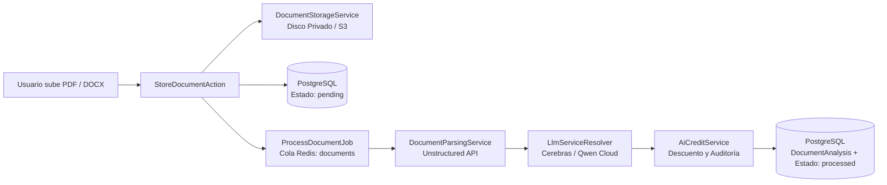

# Auditor-IA — Plataforma SaaS de Auditoría y Análisis Legal con IA

**Auditor-IA** es una plataforma SaaS multi-tenant desarrollada en **Laravel 12** y **PHP 8.3** diseñada para democratizar la comprensión y auditoría de documentos legales en Chile. Permite subir contratos y documentos legales en formato **PDF** o **DOCX** de forma segura y obtener análisis estructurados generados por Inteligencia Artificial: resúmenes ejecutivos, desglose cláusula por cláusula con detección de cláusulas abusivas, evaluación de riesgos con referencia a normativa chilena (Código Civil, Código del Trabajo, Ley 19.496, Ley 18.101), recomendaciones prácticas y explicaciones en lenguaje claro.

> **Manual de Despliegue:** Para instrucciones detalladas de puesta en producción (VPS/Linux, Nginx, Supervisor, PostgreSQL + `pgvector`, Redis, Unstructured API y demo estática en Vercel), consulta el archivo **[`DEPLOYMENT.md`](DEPLOYMENT.md)**.

---

## Funcionalidades Principales

- **Subida Segura y Aislamiento Multi-Tenant:**
  - Validación estricta de archivos PDF/DOCX (`UploadDocumentRequest`), límite configurable (50 MB por defecto) y cálculo de hash SHA-256 para integridad.
  - Almacenamiento en disco privado aislado por organización (`documents/{organization_id}/{year}/{month}/{uuid}`) mediante `DocumentStorageService`.
- **Parsing Documental Estructurado:**
  - Extracción semántica de texto y elementos estructurales (`Title`, `NarrativeText`, `ListItem`, `Table`) vía **Unstructured API** (`DocumentParsingService`).
- **Motor Multi-Proveedor de IA (`LlmServiceResolver`):**
  - **Tier Free:** Inferencia ultrarrápida mediante **Cerebras** (`gpt-oss-20b`) con retención automática de documentos por 7 días (`documents:prune-free`).
  - **Tiers Pro y Lifetime:** Acceso a modelos avanzados en **Qwen Cloud / DashScope** (`qwen3-14b`, `qwen3-max`, `qwen3.5-flash`, `qwen-3.7-flash`) agrupados por niveles (`lightweight`, `standard`, `advanced`, `premium`).
  - **Soporte Extensible y Fallback:** Adaptadores compatibles con OpenAI para **Groq**, **NVIDIA NIM** (con limitación de tasa vía `RateLimitedAdapter`), **DeepSeek** y **Azure OpenAI**.
- **Análisis Contextual Multi-Documento:**
  - Posibilidad de adjuntar documentos de respaldo (anexos, adendas, modificaciones) a un análisis existente (`AnalysisSupportingDocument`) y ejecutar un re-análisis contextual combinado (`ProcessAncillaryAnalysisJob`).
- **Economía de Créditos de IA Auditada:**
  - Sistema de cuotas y libro mayor inmutable de doble entrada (`AiCreditService`, `AiCreditLedger`, `CreditTransaction`) para registrar recargas y consumos por organización.
- **Panel de Administración y Soporte:**
  - Gestión de usuarios, activación/suspensión de organizaciones, auditoría de análisis globales, métricas de plataforma y gestión de tickets de soporte (`BugTicket`).
- **API REST Versionada (`/api/v1`):**
  - Endpoints protegidos con **Laravel Sanctum** y rate limiting para gestionar documentos, disparar parsing, consultar modelos/créditos y ejecutar análisis.
- **Modo Demo Interactivo:**
  - Vista previa funcional en `/demo` y capacidad de exportar un bundle estático sin dependencias de base de datos para **Vercel** (`composer demo:build`).

---

## Arquitectura y Flujo de Funcionamiento

El procesamiento de documentos se ejecuta de manera completamente **asíncrona** para evitar bloqueos HTTP y garantizar escalabilidad:



### Organización del Código (`app/`)

| Directorio | Responsabilidad |
|---|---|
| `app/Actions/` | Casos de uso encapsulados (registro, subida/eliminación de documentos, tickets, gestión admin). |
| `app/DTOs/` | Objetos de transferencia tipados entre controllers, actions y services. |
| `app/Enums/` | Estados y enumeraciones tipadas (`UserRole`, `SubscriptionStatus`, `CreditTransactionType`, etc.). |
| `app/Http/Controllers/` | Controladores web, panel `/admin` y API REST (`Api/V1/`), delegando lógica a Actions/Services. |
| `app/Http/Requests/` | Validación y autorización de entrada mediante Form Requests. |
| `app/Jobs/Documents/` | Jobs asíncronos (`ProcessDocumentJob`, `ProcessAncillaryAnalysisJob`). |
| `app/Models/` | Modelos Eloquent con aislamiento por organización (`Organization`, `Document`, `DocumentAnalysis`, `LawEmbedding`, etc.). |
| `app/Policies/` | Autorización granular por recurso y tenant (`DocumentPolicy`, `DocumentAnalysisPolicy`, etc.). |
| `app/Services/` | Lógica de negocio: `Documents/`, `LLM/` (adaptadores y prompt builders), `Billing/`, `Admin/`, `System/`. |
| `app/Console/Commands/` | Comandos Artisan (`services:check`, `documents:prune-free`, `demo:build-static`). |

---

## Stack Tecnológico

- **Backend:** Laravel 12, PHP `^8.2` (recomendado `8.3+`), Laravel Sanctum 4
- **Base de Datos:** PostgreSQL 15+ con extensión `pgvector` (preparado para RAG en `law_embeddings`)
- **Colas y Caché:** Redis (`phpredis`)
- **Frontend:** Blade, Tailwind CSS v4, Vite 7
- **Parsing Documental:** Unstructured API (Cloud o Docker self-hosted)
- **Proveedores LLM:** Cerebras, Qwen Cloud (DashScope), Groq, NVIDIA NIM, DeepSeek, Azure OpenAI
- **Testing & Calidad:** PHPUnit 11, Laravel Pint, Laravel Pail

---

## Instalación y Uso en Local (Desarrollo)

### 1. Requisitos previos
- PHP `8.2+` (con extensiones `pdo_pgsql`, `pgsql`, `redis`, `mbstring`, `fileinfo`, `openssl`)
- Composer 2
- Node.js `20+` y npm
- PostgreSQL (con extensión `pgvector` instalada)
- Redis en ejecución

### 2. Configuración inicial

```bash
# Clonar repositorio
git clone <URL_DEL_REPOSITORIO> auditor-ia
cd auditor-ia

# Instalar dependencias PHP y JS
composer install
npm install

# Configurar entorno
cp .env.example .env
php artisan key:generate
```

Edita `.env` con tus credenciales locales de PostgreSQL, Redis, Unstructured API y al menos una API Key de LLM (por ejemplo `CEREBRAS_API_KEY`, `GROQ_API_KEY` o `QWEN_API_KEY`).

### 3. Base de datos y datos de demostración

```bash
# Ejecutar migraciones (habilita pgvector y crea todas las tablas)
php artisan migrate

# Poblar planes, modelos de IA, usuarios demo y usuario administrador
php artisan db:seed
```

El seeder crea las siguientes cuentas de prueba (contraseña: `password`):
- **Usuario Free:** `free@auditor-ia.test`
- **Usuario Pro:** `pro@auditor-ia.test`
- **Administrador:** `admin@auditor-ia.test`

### 4. Levantar el entorno de desarrollo

El proyecto incluye un script en `composer.json` que inicia simultáneamente el servidor web, el worker de colas, los logs en tiempo real (Pail) y Vite:

```bash
composer dev
```

Accede a la aplicación en [http://127.0.0.1:8000](http://127.0.0.1:8000) o a la vista previa demo en [http://127.0.0.1:8000/demo](http://127.0.0.1:8000/demo).

### 5. Comandos útiles

```bash
# Verificar conectividad con proveedores LLM y Unstructured API
php artisan services:check

# Ejecutar la suite de pruebas automatizadas
composer test

# Compilar bundle estático de demo para Vercel (carpeta vercel-dist/)
composer demo:build

# Limpiar documentos expirados del plan Free (ejecutado diariamente por el scheduler)
php artisan documents:prune-free --days=7
```

---

## Endpoints Principales de la API (`v1`)

Todas las rutas bajo `/api/v1` requieren autenticación Bearer mediante **Laravel Sanctum** (`auth:sanctum`) y cuentan con rate limiting (`throttle:api`):

- `GET /api/v1/documents` — Listar documentos de la organización autenticada.
- `POST /api/v1/documents` — Subir un nuevo documento PDF/DOCX.
- `GET /api/v1/documents/{document}` — Ver detalle y estado de un documento.
- `POST /api/v1/documents/{document}/parse` — Ejecutar parsing del documento.
- `GET /api/v1/documents/{document}/parsed` — Obtener contenido estructurado extraído.
- `GET /api/v1/ai-models` — Listar modelos de IA disponibles y créditos.
- `POST /api/v1/documents/{document}/analyze` — Iniciar análisis legal con IA.
- `GET /api/v1/documents/{document}/analyses` — Listar análisis de un documento.
- `POST /api/v1/analyses/{analysis}/supporting-documents` — Adjuntar documento de respaldo.
- `POST /api/v1/analyses/{analysis}/analyze-with-context` — Ejecutar re-análisis contextual.

---

## Documentación Adicional del Proyecto

- **[`DEPLOYMENT.md`](DEPLOYMENT.md)** — Manual completo de despliegue en producción (Linux/VPS, Nginx, Supervisor, PostgreSQL/pgvector, Unstructured Docker, Supabase/S3 y Vercel).
- [`PROJECT_DEFENSE_DOCUMENTATION.md`](PROJECT_DEFENSE_DOCUMENTATION.md) — Documentación técnica integral del sistema, arquitectura, seguridad, cumplimiento legal y modelo de negocio.
- [`CLASS_DIAGRAM.md`](CLASS_DIAGRAM.md) — Diagrama de clases de la aplicación.
- [`USER_STORIES_AND_USE_CASES.md`](USER_STORIES_AND_USE_CASES.md) / [`USE_CASES.md`](USE_CASES.md) — Historias de usuario y casos de uso.
- [`TEST_SUITE.md`](TEST_SUITE.md) — Detalle de la suite de pruebas automatizadas.
- [`Auditor-IA_Document_Security_Checklist.md`](Auditor-IA_Document_Security_Checklist.md) / [`PENTESTING_CHECKLIST.md`](PENTESTING_CHECKLIST.md) — Listas de verificación de seguridad y pentesting.

---

## Licencia

Este proyecto está licenciado bajo la licencia [MIT](https://opensource.org/licenses/MIT).
